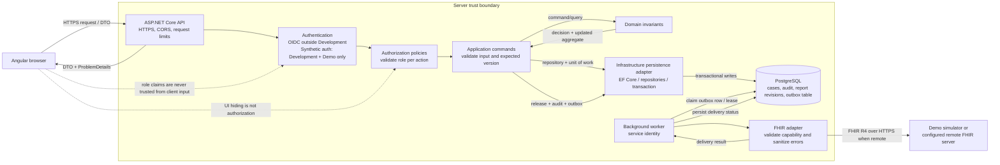

# 05. API, giao diện và bảo mật

## 1. Quy tắc API

- API này là REST API nội bộ của LabWorkflow, không phải FHIR endpoint/server.
- Dùng ASP.NET Core Controllers với ApiController, OpenAPI/Swagger, FluentValidation hoặc validation tương đương theo pattern repo.
- Request/response DTO tách khỏi EF entities, domain types và Firely FHIR POCO.
- Dùng ProblemDetails theo RFC 9457 cho lỗi. Response lỗi có code ổn định để UI không phải phân tích chuỗi message.
- POST tạo tài nguyên trả 201 + Location; truy vấn không có kết quả trả 200 với danh sách rỗng; không tìm thấy ID trả 404.
- Mutation có expected version/ETag; xung đột concurrency trả 409 ProblemDetails.
- Command thay đổi trạng thái yêu cầu Idempotency-Key hoặc resource request key ổn định, nếu retry từ client có thể tạo hành động trùng.

### Ranh giới giao diện, API và bảo mật

Angular improves the workflow but does not grant access: every protected API action applies its policy. The worker uses a separate service identity and never reuses a signed-in user's token. The browser cannot choose an arbitrary FHIR destination.

## 2. Internal API contract đề xuất

Route names là contract nội bộ của showcase. Gemini được đổi naming nhỏ để khớp convention, nhưng không được biến route nội bộ thành FHIR base endpoint.

| Method | Route | Quyền | Mục đích |
|---|---|---|---|
| GET | /api/worklist | Collector, LabTechnician, Reviewer | Lọc case theo trạng thái, correction-pending flag, mã accession, order code, ngày và phân công. Phân trang bắt buộc. |
| GET | /api/cases/{caseId} | Collector, LabTechnician, Reviewer | Chi tiết case, accepted order snapshot/source-version history, specimen, kết quả, report revisions, correction drafts đang/đã xử lý và delivery summary. |
| GET | /api/cases/{caseId}/timeline | Collector, LabTechnician, Reviewer, IntegrationOperator | Audit/workflow timeline, không trả token hoặc raw FHIR request. |
| POST | /api/cases/{caseId}/specimens | Collector | Đăng ký specimen, sinh hoặc lưu accession ID; hỗ trợ idempotency. |
| POST | /api/specimens/{specimenId}/receive | LabTechnician | Ghi nhận nhận mẫu và thời điểm. |
| POST | /api/specimens/{specimenId}/reject | Collector, LabTechnician | Từ chối mẫu, yêu cầu reason code/reason text có giới hạn. |
| PUT | /api/cases/{caseId}/results/{resultSetId} | LabTechnician | Lưu bản nháp result set chưa phát hành với expected version và TestExecutionTime; sau release, mọi sửa đổi phải qua CorrectionDraft. |
| POST | /api/cases/{caseId}/submit-for-review | LabTechnician | Kiểm tra completeness rồi chuyển sang hàng đợi duyệt. |
| POST | /api/cases/{caseId}/reports/release | Reviewer | Tạo revision từ kết quả đang chờ duyệt, phát hành, audit và outbox trong một DB transaction; trả 201 + Location/reportRevisionId. |
| GET | /api/cases/{caseId}/reports/{reportRevisionId} | Collector, LabTechnician, Reviewer | Đọc snapshot đã phát hành theo quyền dữ liệu; không trả raw integration payload. |
| POST | /api/cases/{caseId}/reports/{reportRevisionId}/correction-drafts | LabTechnician | Tạo correction draft đầy đủ dựa trên report revision mới nhất; bắt buộc reason, expected version và Idempotency-Key. |
| POST | /api/cases/{caseId}/correction-drafts/{draftId}/cancel | LabTechnician (author) hoặc Reviewer | Hủy draft chưa phát hành, bắt buộc reason và audit. |
| POST | /api/cases/{caseId}/correction-drafts/{draftId}/release | Reviewer | Reviewer khác người tạo draft phát hành correction thành revision mới, audit và outbox nguyên tử. |
| GET | /api/integrations/fhir/outbox | IntegrationOperator | Lọc thông điệp theo trạng thái, thời gian và destination. Không trả clinical payload mặc định. |
| POST | /api/integrations/fhir/outbox/{messageId}/retry | IntegrationOperator | Lên lịch retry/reconciliation sau khi đã xem lỗi. |
| GET | /health/live | Anonymous hoặc infra policy | Liveness; process còn sống. Không kiểm tra dependency chậm. |
| GET | /health/ready | Anonymous hoặc infra policy | Readiness: DB/migration/config cần thiết và FHIR mode state. Không lộ secret. |

Initial release không nhận reportRevisionId vì chính command này tạo revision bất biến mới. Request mang expected aggregate version và Idempotency-Key; API chỉ trả thành công sau khi transaction gồm revision + audit + outbox commit. CorrectionDraft phải tham chiếu revision mới nhất; report gần nhất phải Delivered/đã đối soát, và chỉ có một draft active/case. Draft có full snapshot để Reviewer so sánh nhưng chưa phải report, chưa tạo outbox và không đổi trạng thái delivery. Release draft kiểm tra Reviewer khác author, expected version và draft còn dựa trên revision mới nhất; sau đó mới tạo Correction ReportRevision và outbox trong một DB transaction. Draft sai phải được hủy có audit rồi tạo lại, không sửa draft đã submit.

Initial release body; `expectedCaseVersion` là version của aggregate LabCase trong PostgreSQL, không phải FHIR `meta.versionId`:

~~~json
{
  "expectedCaseVersion": 12,
  "reviewNote": "Synthetic review note"
}
~~~

Correction draft body mang `expectedCaseVersion` (LabCase local version), reason đã mã hóa, `TestExecutionTime` dạng instant hoặc period và **toàn bộ** corrected result components, không chỉ phần thay đổi. `reportRevisionId` trong route là revision gốc; nó phải bằng revision mới nhất đã Delivered/đối soát tại cả lúc tạo draft và release. Các result component phải khớp đầy đủ cùng panel/specimen rule; sửa một giá trị vẫn gửi lại full snapshot để Reviewer so sánh. Khi draft được tạo, response trả `draftId` và version aggregate mới để request release dùng tiếp. Ví dụ rút gọn:

~~~json
{
  "expectedCaseVersion": 18,
  "reason": {
    "system": "urn:labworkflow:synthetic-correction-reasons",
    "code": "transcription-error",
    "display": "Synthetic data-entry correction"
  },
  "testExecutionTime": {
    "kind": "instant",
    "value": "2026-09-27T02:30:00Z"
  },
  "resultComponents": [
    {
      "componentKey": "synthetic-analyte-a",
      "valueType": "quantity",
      "value": 7.25,
      "unit": { "system": "http://unitsofmeasure.org", "code": "mmol/L", "display": "mmol/L" }
    }
  ]
}
~~~

Correction release body mang `expectedCaseVersion` mới nhất; server so sánh lại với draft, aggregate và base revision, rồi tạo Correction ReportRevision. Cancel body có `expectedCaseVersion` cùng `reason`. Mọi command dùng `Idempotency-Key`; API trả 201 cho draft/revision mới, 409 khi stale version/base revision, report chưa Delivered/đối soát hoặc draft đã xử lý, 422 cho snapshot chưa đủ/không hợp lệ, 403 khi sai role hoặc Reviewer trùng author. FHIR `If-Match`/ETag là version riêng ở tầng connector, được chụp trong outbox khi Reviewer phát hành correction.

### DTO patterns

Create specimen body:

~~~json
{
  "specimenType": {
    "system": "urn:example:lab-specimen",
    "code": "serum",
    "display": "Synthetic serum"
  },
  "collectedAt": "2026-09-27T02:30:00Z",
  "accessionIdentifier": "LAB-DEMO-000123"
}
~~~

Result value phải có discriminant type rõ ràng. Ví dụ concept cho kết quả số:

~~~json
{
  "valueType": "quantity",
  "value": 7.25,
  "unit": {
    "system": "http://unitsofmeasure.org",
    "code": "mmol/L",
    "display": "mmol/L"
  }
}
~~~

ResultSet draft cũng mang thời gian xét nghiệm, riêng với thời điểm người dùng nhập dữ liệu:

~~~json
{
  "expectedCaseVersion": 9,
  "testExecutionTime": {
    "kind": "period",
    "start": "2026-09-27T02:00:00Z",
    "end": "2026-09-27T02:30:00Z"
  },
  "components": [
    {
      "componentKey": "synthetic-analyte-a",
      "valueType": "quantity",
      "value": 7.25,
      "unit": { "system": "http://unitsofmeasure.org", "code": "mmol/L", "display": "mmol/L" }
    }
  ]
}
~~~

Server derives actor, `enteredAt`, report `issued` and audit timestamps from authenticated identity/clock; clients cannot set these fields. A ResultSet already included in a released ReportRevision is immutable through this endpoint; use the correction flow.

Ví dụ trên là fixture giả để kiểm thử serialization/UI; code specimen, analyte, kết quả và đơn vị không được coi là kết quả thật hoặc hướng dẫn chẩn đoán. Gemini không được hard-code giá trị bình thường/critical.

## 3. Worklist UI

### Màn hình bắt buộc

1. **Worklist:** tab/quick filters cho AwaitingSpecimen, InProgress, AwaitingReview, Released, CorrectionPendingReview và ReconciliationRequired; sort/paging; tìm accession/order code. Correction pending là badge riêng; report cũ vẫn là report hiện hành.
2. **Case detail:** patient reference tối thiểu, order code/source/version, timeline, danh sách specimen và trạng thái integration.
3. **Specimen panel:** tạo accession, nhập/scan mã, nhận/từ chối kèm reason; chống thao tác hai lần.
4. **Result entry:** form phát sinh từ TestDefinition; bắt đúng value type/unit; hiển thị completeness trước khi submit.
5. **Review/release:** read-only snapshot, người nhập, mẫu liên quan, thành phần thiếu, version và xác nhận phát hành. Correction review hiển thị song song snapshot đã phát hành, full corrected snapshot, lý do, author, base revision và version dự kiến. Hủy draft yêu cầu reason; UI thể hiện report cũ vẫn là bản phát hành hiện hành trong lúc chờ duyệt.
6. **Integration operations:** danh sách outbox và sanitized error code; retry cần xác nhận, quyền Operator và audit.
7. **Actor switcher chỉ trong Development:** chọn các synthetic identities để demo roles; không tồn tại ở môi trường khác.

### Hành vi giao diện

- Sau mỗi command, dùng server response làm nguồn chuẩn; không tự sửa trạng thái trong client như thể server đã lưu.
- Vô hiệu hóa double submit nhưng vẫn dựa vào API idempotency/concurrency.
- Hiển thị riêng badge Report released và EHR delivery status.
- Hiển thị timestamp theo timezone người dùng nhưng gửi/lưu UTC.
- Trường mã hiển thị code + system; không chỉ render display string.
- UI không tính reference range, không tô màu chẩn đoán.
- Có loading, empty, validation, stale version, permission denied, integration delayed và recoverable error states.

## 4. Authentication và authorization

### Local demo

- Bật Development-only synthetic authentication để chọn identity Collector, Technician, Reviewer, Operator, Admin.
- API chỉ đăng ký synthetic handler khi ASPNETCORE_ENVIRONMENT=Development và Fhir:Mode=Demo. Nếu điều kiện không đúng, app fail startup.
- Có thể dùng header dev-only để mô phỏng user, nhưng middleware phải từ chối nếu không ở Development. Không cho phép header giả role trong staging/production.
- Demo không có login/password người dùng thật và không phải mẫu để deploy như identity provider.

### Staging/production integration target

- Dùng OIDC provider do tổ chức triển khai; validate issuer, audience, signature, expiry và token policy.
- Role/policy nội bộ: LabCollector, LabTechnician, LabReviewer, LabIntegrationOperator, LabAdministrator.
- API kiểm tra quyền ở từng action. UI ẩn nút không thay thế authorization.
- Tách scope FHIR machine client khỏi quyền nhân viên. Worker không dùng token của user đã đăng nhập.
- Remote backend service cần scope tối thiểu đã được partner phê duyệt. Có thể dùng SMART Backend Services/private-key JWT khi server hỗ trợ; cách auth khác phải theo contract partner.
- Không tạo identity provider production trong scope project này.

## 5. Audit và quyền truy cập

- Ghi actor, role/policy, action, resource reference, timestamp, outcome, reason và correlation ID cho mutations trọng yếu.
- Audit các lần xem report/result nhạy cảm nếu yêu cầu vận hành/privacy review; bản demo ít nhất audit mọi thay đổi và release/retry.
- Không dùng audit timeline thay application tracing, và không dùng log thay audit database.
- Audit entry append-only từ application; API bình thường không có chức năng xóa/sửa audit.
- Có thể xuất FHIR AuditEvent hoặc Provenance khi partner IG yêu cầu, nhưng mapping phải được định nghĩa riêng.
- IntegrationOperator xem error metadata, không mặc nhiên được xem toàn bộ kết quả lâm sàng.
- Database role của ứng dụng là least privilege; secret riêng theo môi trường.

## 6. Threat boundaries và dữ liệu

- Browser request và FHIR resources đều là input không tin cậy; validate type, size, coding, references, URL, date/time và profile.
- FHIR base URL được admin cấu hình; không nhận URL đích tùy ý từ request browser để tránh SSRF.
- Chỉ HTTPS cho remote, validate TLS certificate mặc định; không tắt certificate validation trong demo code.
- Rate limit endpoints đăng nhập/expensive search nếu OIDC gateway chưa xử lý.
- CORS chỉ whitelist origin UI cấu hình.
- Secrets không vào Git, UI bundle, API response hoặc logs.
- App, proxy và database cần phân vùng/network policy theo môi trường triển khai. Không expose PostgreSQL public.
- Thực hiện privacy/security review trước khi dùng dữ liệu bệnh nhân thật; tài liệu này không nêu thời hạn lưu trữ pháp lý chung.

## 7. Quy tắc log/sự kiện

- Được log: trace ID, route template, duration, status code, aggregate ID dạng opaque, FHIR resource type, partner key, retry count, outcome code.
- Không log: token, secret, private key, patient name, full patient identifier, raw FHIR JSON, raw report/result, connection string.
- EF Core sensitive-data logging tắt mặc định.
- OperationOutcome trước khi log phải được sanitize; lưu issue code/diagnostics đã lọc.
- Correlation ID theo request/outbox message giúp truy vết mà không nhét PHI vào trace baggage.

