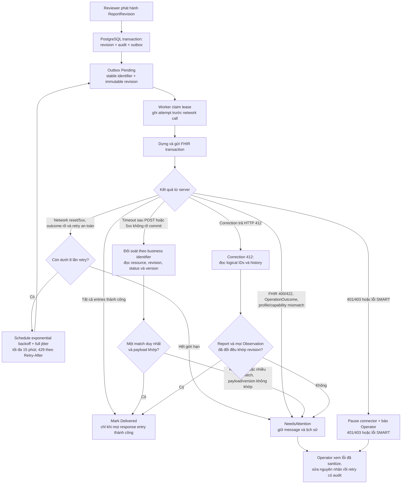

# 06. Độ tin cậy, vận hành và triển khai

## 1. Mô hình nhất quán

| Ranh giới | Cơ chế | Đảm bảo |
|---|---|---|
| Domain update → PostgreSQL | Một DB transaction + constraints + optimistic concurrency | Toàn bộ thay đổi cục bộ commit hoặc rollback. |
| Release report → outbox | Cùng DB transaction | Không có report đã release mà thiếu message outbox tương ứng. |
| Outbox → FHIR server | At-least-once delivery + stable identifiers + conditional operation/reconciliation | Có thể retry sau restart; duplicate effects phải được ngăn/đối soát theo khả năng server. Không đảm bảo exactly-once qua mạng. |
| FHIR transaction | Transaction Bundle trên một server | Server chấp nhận toàn bộ hoặc từ chối transaction theo FHIR R4; không bao gồm local PostgreSQL. |
| API → Angular | HTTP response + version/ETag | UI phản ánh trạng thái server; stale mutation bị phát hiện thay vì ghi đè. |

## 2. Durable outbox worker

### Ghi và claim message

- Release transaction thêm OutboxMessage với status Pending và idempotency key duy nhất.
- Worker query message due, claim bằng lease có expiration và concurrency check. PostgreSQL implementation có thể dùng row locking/skip-locked hoặc atomic lease update.
- Worker cập nhật attempt count và lease trước network call.
- Khi process chết, lease hết hạn để message có thể được claim lại.
- Worker shutdown tôn trọng CancellationToken, dừng nhận việc mới và giữ message chưa hoàn tất để retry.
- Message payload được dựng từ immutable ReportRevision; nếu lưu raw Bundle snapshot, coi đó là dữ liệu nhạy cảm, giới hạn quyền và retention.

### Retry và phân loại lỗi

| Loại lỗi | Hành động |
|---|---|
| DNS/network reset/timeout/HTTP 5xx | Retry exponential backoff có jitter; giữ attempt metadata; tránh tạo resource mới. |
| HTTP 429 | Tuân theo Retry-After nếu server trả; nếu thiếu thì dùng configured backoff. |
| HTTP 401/403 hoặc SMART token lỗi | Pause destination/connector, alert operator; không đốt retry liên tục. |
| FHIR 400/422, OperationOutcome validation error | Chuyển NeedsAttention; không auto-retry cùng Bundle cho đến khi dữ liệu/config được sửa. |
| Capability/profile mismatch | Connector degraded/blocked, message vẫn pending hoặc NeedsAttention theo lỗi; yêu cầu sửa cấu hình/profile. |
| Timeout sau POST, không biết transaction đã commit chưa | Trạng thái ambiguous; reconciliation/identifier lookup hoặc conditional operation trước khi quyết định gửi lại. |

Demo mặc định: tối đa 8 lần retry tự động với exponential backoff, full jitter và giới hạn tối đa 15 phút giữa lần thử; cấu hình được và thay đổi theo partner contract. Sau đó chuyển NeedsAttention nhưng giữ message bền vững. Operator retry tạo một lần thử mới có audit; không xóa hoặc reset lịch sử cũ.

Chỉ áp dụng HTTP-level automatic retry cho operation an toàn/idempotent. Transaction POST không được retry vô điều kiện bởi Polly/HTTP handler bên dưới outbox.

### Luồng phát hành, gửi, retry và đối soát

Với timeout sau POST hoặc HTTP 412, worker không gửi lại mù. Chỉ gửi lại khi đã đối soát trạng thái hiện tại và operation an toàn theo CapabilityStatement cùng contract test; nếu không chứng minh được thì để `NeedsAttention` cho Operator.

## 3. Reconciliation

- Mỗi outgoing revision có business identifier ổn định và destination key.
- Nếu response thất lạc, tìm resource/report theo identifier và so sánh revision/version/status trước khi gửi lại.
- Có thể dùng conditional create/update chỉ khi partner CapabilityStatement và test xác nhận.
- Nếu tìm được một match duy nhất và payload tương thích, hoàn tất local delivery record.
- Nếu không match hoặc có nhiều match, giữ NeedsAttention và tạo việc reconciliation cho Operator.
- Không kết luận Delivered chỉ dựa vào việc socket POST không ném lỗi; phải parse FHIR response bundle/entry statuses.

## 4. Import recovery

- Persist cursor/watermark theo FHIR endpoint.
- Một `ServiceRequest` identity luôn trỏ tới cùng IncomingOrder/LabCase; ghi từng source version vào lịch sử trước khi cập nhật checkpoint.
- Dùng overlap window + idempotent resource-version key để tránh khoảng trống do timestamp trùng hoặc pagination.
- Lưu pagination link cursor nếu quá trình chia batch có thể dừng giữa chừng.
- Một resource lỗi tạo IntegrationIssue; operator có thể xem, sửa mapping/config hoặc reprocess.
- Cập nhật checkpoint và imported rows cùng transaction hoặc bằng tiến trình có thể resume mà không bỏ sót dữ liệu.
- Nếu version mới tới sau khi lab nhận việc/bắt đầu, giữ accepted snapshot cũ, lưu normalized old/new snapshots và tạo IntegrationIssue; operator quyết định version nào được chấp nhận.

## 5. Database và phục hồi

- PostgreSQL là nguồn dữ liệu cho LabCase, specimen, result draft, report revisions, audit và outbox.
- Schema migrations được commit; migration không tự chạy destructive drop khi khởi động production.
- Index cho accession unique, nguồn order/version unique, worklist filters, due outbox, case timeline.
- Dùng DB constraint cho invariants cần bảo vệ dưới concurrent requests.
- Demo có health check DB và hướng dẫn backup/restore test. Production phải đặt RPO/RTO, retention và encrypted backup theo chủ hệ thống; tài liệu không bịa ra SLA.
- Seed data chỉ chạy ở Development và idempotent; không ghi đè database đang có dữ liệu.

## 6. Observability

### Structured logs

Có timestamp UTC, severity, service, environment, trace/span ID, route template, actor opaque ID, case ID opaque, source/destination key, FHIR interaction, attempt number và sanitized error code.

### Metrics

- HTTP request duration/error count.
- FHIR import age/watermark lag and imported/rejected resource counts.
- Outbox pending count, oldest pending age, retry count, NeedsAttention count.
- FHIR latency by endpoint/interaction, response category and transaction failure count.
- Database connectivity, worker active/idle/lease-expiration counts.

### Traces

Một trace context nối inbound HTTP command → DB transaction → outbox message → FHIR client operation. Không đặt patient name/identifier/result vào span attributes hoặc baggage.

### Alerts for production-like pilot

- Oldest pending outbox vượt ngưỡng cấu hình.
- Connector bị 401/403 hoặc preflight capability/profile thay đổi.
- Tỷ lệ OperationOutcome validation errors tăng.
- Readiness DB failure, worker không heartbeat, lease kẹt.
- Không đặt ngưỡng cảnh báo mặc định mang tính cam kết; đối tác chọn dựa theo operating hours và SLA.

## 7. Local deployment profile

### Cấu hình mặc định

- PostgreSQL container có named volume.
- API trên port 5156.
- Angular dev UI trên port 4300.
- Demo FHIR gateway dùng fixtures/local simulator; không có outbound call ra mạng ngoài.
- Demo authentication chỉ chạy trong Development.
- Synthetic seed data; startup báo rõ Demo mode.

### Production-like integration profile

- API và worker container riêng; PostgreSQL managed/private.
- HTTPS ingress/reverse proxy, secret manager, non-root container user, network policy.
- FHIR remote mode yêu cầu URL allowlist/cấu hình rõ, TLS, token provider, private-key reference và capability preflight.
- Worker scale bằng lease/DB locking; API scale ngang sau khi session/auth/client state đã stateless.
- Database migrations chạy từ release job có kiểm soát; API không dùng superuser.
- Cấu hình backup, restore drill, retention, alerting, key rotation, incident owner và deployment rollback.

## 8. Runbook thao tác

### FHIR server không truy cập được

1. Kiểm tra readiness connector và host/HTTPS/certificate.
2. Xác nhận SMART token hoặc credential state mà không hiển thị secret.
3. Xem outbox oldest age và loại lỗi.
4. Không đánh dấu report failed/cancelled chỉ vì EHR offline; report nội bộ vẫn Released, delivery vẫn pending.
5. Sau khi khôi phục, worker retry theo schedule; operator chỉ can thiệp ambiguous/permanent errors.

### Message vào NeedsAttention

1. Mở lỗi theo correlation ID và sanitized OperationOutcome.
2. Phân loại data/profile/auth/capability/idempotency.
3. Sửa profile/code mapping hoặc quyền với người sở hữu tích hợp.
4. Chạy đối soát identifier trên server trước khi retry lỗi ambiguous.
5. Retry bằng quyền Operator, ghi reason; kiểm tra response entry từng resource.

### Báo cáo bị sửa sau khi phát hành

1. Không sửa DB trực tiếp.
2. Chỉ bắt đầu khi report revision gần nhất đã Delivered/đối soát; LabTechnician tạo correction draft từ revision đó, cung cấp full result snapshot và reason.
3. Reviewer khác author so sánh bản đã phát hành, bản sửa và lý do rồi phát hành correction.
4. Worker cập nhật cùng FHIR logical IDs bằng If-Match ETags. Với HTTP 412, không retry vô điều kiện: đọc latest/history và chuyển reconciliation.
5. Xác nhận revision lịch sử được giữ, outbox revision mới Delivered và PublishedResourceLinks chứa version/ETag mới nhất.

Nếu FHIR transaction có thể đã commit nhưng response bị mất, lần retry dùng ETag đã chụp sẽ không ghi đè: khi server trả 412, operator/worker đọc resources qua PublishedResourceLinks và so khớp trạng thái hiện tại với correction ReportRevision. Chỉ xác nhận Delivered nếu report và mọi Observation thay đổi đều khớp; mọi sai khác khác đi vào NeedsAttention.

## 9. Độ tin cậy và giới hạn

- **M1 demo:** có thể đạt độ tin cậy tốt cho workflow local nếu PostgreSQL transaction, outbox, idempotency, restart recovery và concurrency tests được nghiệm thu.
- **M2 FHIR test:** chất lượng phụ thuộc server simulator/test; cần contract tests chạy với endpoint/version/profile đích.
- **Pilot/production:** tài liệu/code mẫu không đủ để kết luận đáp ứng availability, privacy, quality management, legal retention hoặc patient safety requirements. Cần threat model, operational rehearsal, clinical review và partner sign-off.
- Outbox bảo vệ message khỏi process restart; nó không thay backup database, failover DB, idempotent remote contract hay người xử lý dead-letter.
- Nếu dùng queue broker về sau, giữ message key/schema/version và outbox semantics; không thêm broker trong M1 chỉ để tạo cảm giác microservice.

