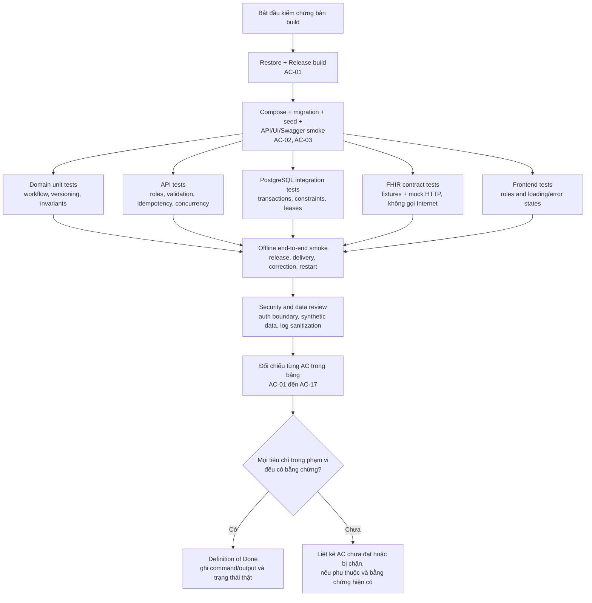

# 07. Kiểm thử và tiêu chí nghiệm thu

## 1. Chiến lược test

### Unit tests — Domain

Kiểm thử transition và invariants không cần database/HTTP:

- ServiceRequest mới tạo một IncomingOrder/LabCase; duplicate version key là no-op; version mới tạo history row nhưng không tạo case thứ hai.
- IncomingOrder.AcceptedImportedOrderVersionId là nguồn chuẩn duy nhất; LabCase không lưu pointer bản sao. Version mới trước khi lab nhận việc có thể dịch pointer này trên cùng case, nguyên tử với audit; version mới sau khi work bắt đầu giữ accepted pointer và tạo ReconciliationRequired + IntegrationIssue với cả hai snapshot trong cùng transaction.
- Không đăng ký specimen cho order đã cancel hoặc đang reconciliation.
- Accession identifier trùng bị từ chối.
- Specimen bị từ chối không thể có result set để phát hành.
- Thiếu component bắt buộc thì submit-for-review bị từ chối.
- Reviewer-only release; role không đủ quyền không thể gọi command.
- Release tạo immutable snapshot; correction tạo revision mới với reason.
- CorrectionDraft chứa full snapshot, base revision mới nhất đã Delivered, expected LabCase version và reason; Reviewer phải khác author.
- Không cho correction draft/release khi base revision cũ, report delivery chưa xong, draft đã tồn tại, hoặc version stale.
- Stale aggregate version không ghi đè.

### Application/API tests

- WebApplicationFactory xác minh route, validation, policies, ProblemDetails và status codes.
- Kiểm thử mỗi endpoint với quyền đúng/sai và identity synthetic.
- Idempotency-Key lặp lại trả cùng kết quả mà không sinh hai specimen, audit action hoặc report revision.
- API contract không serialize EF entities hoặc Firely POCO.
- Pagination/filter worklist ổn định và có giới hạn page size.

### PostgreSQL integration tests

- Dùng PostgreSQL thật qua Testcontainers hoặc môi trường CI tương đương; InMemory provider không đủ để xác minh locking, constraint, transaction và migration.
- Import version ServiceRequest commit ImportedOrderVersion + LatestObservedVersionId và, nếu đủ điều kiện, AcceptedImportedOrderVersionId + audit cùng nhau; khi có conflict, version history + IntegrationIssue + audit commit cùng nhau. Inject failure xác nhận toàn bộ thay đổi trong mỗi nhánh rollback.
- Release transaction commit report + audit + outbox cùng nhau.
- Inject failure giữa transaction: cả ba cùng rollback.
- Concurrent release/receive hai request: một request commit, request stale nhận 409.
- Outbox claim không phát cùng một local lease cho hai worker song song.
- Process restart không làm mất pending/NeedsAttention message.
- Migration từ database rỗng dựng được đúng index/constraint.

### FHIR contract tests

- Fixture R4 parse/serialize giữ được resource type, references, code system, status và decimal precision.
- ServiceRequest fixture import đúng subject/reference, code, intent/status/id/version.
- Specimen request reference có semantics đúng với order tạo trước specimen.
- DiagnosticReport liên kết ServiceRequest, Specimen và Observation theo profile fixture.
- DiagnosticReport có `effective[x]` từ TestExecutionTime tường minh và `issued` từ thời điểm phát hành; thiếu TestExecutionTime bị chặn, không thay bằng `issued`.
- Report đầu tiên serialize status `final`; correction serialize version-aware update với status `corrected`; M1 không tạo nhiều report hoặc partial report cho một LabCase.
- Correction giữ FHIR logical ID/business identifier của DiagnosticReport; chỉ Observation có value thay đổi mới update, với ID ổn định theo component. If-Match cũ trả 412; ETag/meta.versionId tăng; vread/history vẫn trả bản trước.
- Transaction Bundle có fullUrl/reference resolution hợp lệ.
- Mỗi entry response được kiểm tra; bundle có một entry lỗi không được local đánh Delivered.
- Validation thất bại trả OperationOutcome đã sanitize và tạo NeedsAttention.
- Remote HTTP tests chạy qua mock HTTP server, không gọi Internet/server thật trong CI.

### Frontend tests

- Route/page render cho worklist, case, specimen, result, review, timeline và integration.
- Role khác nhau nhìn thấy controls phù hợp; API vẫn là nơi quyết định quyền.
- Loading/empty/validation/conflict/403/network retry states có behavior test.
- Numeric, coded và text result DTO được serialize theo discriminant, không bị locale browser đổi decimal separator.

### End-to-end smoke

- Chạy PostgreSQL + API + worker + UI.
- Dùng demo identity.
- Thực hiện order fixture → specimen receive → result entry → reviewer release → outbox simulator accepts transaction → UI hiển thị Delivered.
- Dùng LabTechnician khác tạo correction draft với full snapshot/reason → Reviewer khác phát hành → simulator giữ logical IDs, tăng ETag/version và vẫn cho đọc version cũ.
- Restart API/worker sau khi có pending message và xác nhận message vẫn được gửi/đối soát đúng.

### Luồng kiểm chứng và cổng nghiệm thu

Sơ đồ này là trình tự nghiệm thu dự kiến, không phải kết quả test của thư mục hiện tại. Remote mode hoặc partner profile chỉ được đánh dấu đạt khi có mock/contract evidence tương ứng; các phụ thuộc chưa có phải ghi là chưa xác minh.

## 2. Acceptance criteria

| ID | Tiêu chí đạt |
|---|---|
| AC-01 | Developer có thể restore/build solution Release từ thư mục project bằng .NET 10 SDK. |
| AC-02 | Development compose khởi động PostgreSQL; migration và seed synthetic data hoàn tất mà không cần mạng hoặc credential FHIR. |
| AC-03 | API chạy port 5156, UI chạy port 4300, Swagger mở được; file LabWorkflow.http có các luồng API demo chính. |
| AC-04 | Người dùng có thể lọc worklist, mở case, tạo specimen accession duy nhất, ghi nhận receive/reject và xem timeline. |
| AC-05 | Người dùng nhập được result type hợp lệ; hệ thống chặn missing component, sai code/unit type và result từ specimen bị reject. |
| AC-06 | Kỹ thuật viên gửi review; chỉ Reviewer được release; release tạo một report revision + audit + outbox nguyên tử; report thiếu TestExecutionTime không được release. |
| AC-07 | Report released bất biến; LabTechnician tạo correction draft full snapshot có reason; Reviewer khác author phát hành correction thành revision mới/status FHIR `corrected`; report status không bị trộn với delivery status. |
| AC-08 | Firely SDK R4 parse/serialize synthetic fixtures; bundle có effective[x]/issued đúng nghĩa và tham chiếu đúng resource; correction giữ logical IDs, dùng If-Match, tăng version và giữ vread/history; structural validation errors không được publish; partner profile validation chỉ được đánh dấu đạt khi có IG đã pin. |
| AC-09 | Demo worker gửi bundle đến local simulator; report chỉ hiện Delivered khi response entries thành công. |
| AC-10 | Restart worker/API không mất pending message; retry không tạo duplicate effect trong simulator. |
| AC-11 | Stale concurrent mutation trả 409; command lặp có idempotency key không nhân đôi side effect. |
| AC-12 | User không đủ role bị 403; demo authentication startup fail nếu bật ngoài Development + Demo mode. |
| AC-13 | Automated tests dùng data synthetic; CI không gọi endpoint FHIR public/partner. |
| AC-14 | Logs/traces không chứa tokens, private keys, raw FHIR bundles, patient name/identifier hay result value. |
| AC-15 | Remote mode fail closed khi thiếu BaseUrl/auth hoặc CapabilityStatement thiếu required interaction; correction bị khóa nếu thiếu versioned-update/If-Match/history contract; không rơi về demo mode. |
| AC-16 | README nói rõ chạy local, demo identity, dữ liệu giả, trạng thái source/test thật và giới hạn production. |
| AC-17 | Mọi version ServiceRequest được lưu dưới một IncomingOrder/LabCase; duplicate version idempotent; IncomingOrder.AcceptedImportedOrderVersionId là pointer chuẩn duy nhất, đổi pointer cùng audit trong một transaction; update đang xử lý giữ snapshot cũ và ghi IntegrationIssue đối soát nguyên tử. |

## 3. Lệnh nghiệm thu mục tiêu

Sau khi source được tạo, Gemini phải chạy và báo output thật của:

~~~powershell
dotnet restore .\LabWorkflow.slnx
dotnet build .\LabWorkflow.slnx -c Release --no-restore
dotnet test .\LabWorkflow.slnx -c Release --no-build
npm ci --prefix .\web\LabWorkflow.Web
npm run test --prefix .\web\LabWorkflow.Web
npm run build --prefix .\web\LabWorkflow.Web
docker compose -f .\compose.yaml config
~~~

E2E smoke phải được chạy theo README trong môi trường local. Không ghi “all tests passed” nếu command không chạy hoặc output không xác nhận thành công. Không dùng EF InMemory thay PostgreSQL cho test transaction/outbox.

## 4. Definition of Done

- Đạt AC-01 đến AC-17 hoặc ghi rõ từng tiêu chí bị chặn bởi phụ thuộc ngoài.
- Unit/API/PostgreSQL/FHIR contract tests chạy offline, repeatable.
- E2E happy path và retry/restart path có bằng chứng output/screenshot/log sanitized.
- OpenAPI và API .http khớp controller thực tế.
- Không còn demo auth/credential path vô tình bật trong non-Development.
- Migration, seed, compose và README đồng bộ với source.
- Không còn TODO/TBD trong luồng bắt buộc; lỗi ngoài scope được ghi rõ.
- Kiểm tra git status để không ghi đè thay đổi người dùng có sẵn trong project 120.

