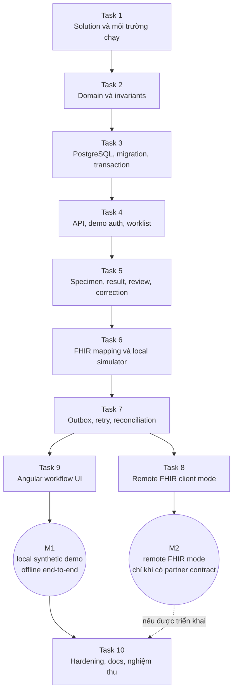

# 08. Kế hoạch triển khai theo lát cắt

## Bản đồ các giai đoạn

Task 1–7 tạo luồng backend local; Task 9 hoàn thiện UI cho M1. Task 8 mở rộng sang remote FHIR và cần capability/profile/auth contract của partner. Có thể nghiệm thu M1 mà không có partner endpoint; không đánh dấu M2 đạt nếu chưa có bằng chứng kiểm thử tương ứng.

## Goal

Tạo project .NET 10 độc lập minh họa một luồng điều phối xét nghiệm từ chỉ định tổng hợp đến phát hành báo cáo FHIR R4 và gửi outbox đến simulator, đồng thời có đường nâng cấp sang FHIR server remote.

## Architecture

Modular monolith với ASP.NET Core Controllers, Domain/Application/Infrastructure/FHIR modules, worker riêng và Angular client tối thiểu. PostgreSQL giữ workflow/audit/outbox; FHIR adapter tách internal model khỏi external resources. Demo mode phải chạy không cần credential hoặc network.

## Tech stack

- .NET 10 / C# 13, ASP.NET Core Controllers, EF Core 10. Pin `<LangVersion>13.0</LangVersion>` in `Directory.Build.props` to match this repository's declared .NET 10/C# 13 convention even though the .NET 10 SDK defaults to C# 14.
- PostgreSQL và Npgsql provider tương thích EF Core 10.
- Firely .NET SDK 6 R4 package Hl7.Fhir.R4; matching validation package and pinned partner IG only for remote profile validation.
- .NET Worker Service, durable PostgreSQL outbox.
- Angular major còn được hỗ trợ tại thời điểm triển khai.
- xUnit, FluentAssertions, WebApplicationFactory, Testcontainers/PostgreSQL và HTTP mock server.
- OpenTelemetry, Docker Compose, Swagger/OpenAPI, LabWorkflow.http.

## Global constraints

- Target framework phải là net10.0.
- API phải dùng ASP.NET Core Controller + ApiController theo root README của repo.
- Không tạo FHIR server bằng cách dùng Firely SDK; Firely là library/client/parser/validator.
- Không dùng PHI thật; mọi fixture/seed/test patient phải synthetic và được đánh dấu.
- Demo mode chạy offline; remote mode chỉ bật bằng config rõ ràng và fail closed.
- FHIR R4 là release của bản đầu; đổi FHIR release hoặc partner IG cần mapping/contract test tương ứng.
- Dữ liệu domain/EF/API DTO không được phụ thuộc Firely POCO.
- Release report + audit + outbox phải commit trong một PostgreSQL transaction.
- Không ghi FHIR transaction POST tự động retry vô điều kiện.
- Không ghi “exactly once”; dùng at-least-once delivery, stable key, idempotency và reconciliation.
- Không sửa/xóa ReportRevision đã phát hành; correction tạo revision mới. M1 có đúng một chuỗi DiagnosticReport cho mỗi LabCase, không phát hành partial/multi-report.
- Mỗi ReportRevision phải có TestExecutionTime và IssuedAt riêng; `effective[x]` không được thay bằng `issued` hoặc giờ hiện tại.
- Không update hoặc revert file thay đổi sẵn trong project 120.
- Chưa có project code nào trong thư mục 121; README phải ghi implementation/test status dựa trên kết quả thực tế.
- Không commit/push hoặc mở PR nếu người dùng không yêu cầu.

## Thứ tự triển khai

### Task 1 — Tạo solution độc lập

**Tạo trong:** 121-LabWorkflow/

**Tạo projects:**

- src/LabWorkflow.Domain
- src/LabWorkflow.Application
- src/LabWorkflow.Infrastructure
- src/LabWorkflow.Fhir
- src/LabWorkflow.Api
- src/LabWorkflow.Worker
- web/LabWorkflow.Web
- tests/LabWorkflow.Domain.Tests
- tests/LabWorkflow.Application.Tests
- tests/LabWorkflow.Integration.Tests
- tests/LabWorkflow.Fhir.ContractTests

**Yêu cầu:**

- Solution file LabWorkflow.slnx.
- `Directory.Build.props` pins `LangVersion` 13.0, nullable and implicit usings across .NET projects.
- Tất cả .NET project target net10.0; nullable và implicit usings bật.
- Áp dụng project reference direction ở tài liệu 03.
- API Controller chạy port 5156, Angular dev chạy port 4300.
- Tạo LabWorkflow.http, compose.yaml với PostgreSQL, và root README của project.

**Kiểm tra:** restore/build solution; API khởi động và Swagger hiển thị một controller health/demo. Không bắt đầu FHIR remote ở task này.

### Task 2 — Domain model và quy tắc

**Tạo trong:** Domain, Application, Domain.Tests.

**Implement:** IncomingOrder + ImportedOrderVersion, LabCase, Specimen, TestDefinition, ResultSet/ResultComponent, ReportRevision (gồm TestExecutionTime và IssuedAt riêng), CorrectionDraft, OutboxMessage, AuditEntry và IntegrationIssue theo tài liệu 02. Bắt đầu bằng transition factories/methods có invariant rõ; không tạo public setters cho trạng thái.

**Feature slices trước mắt:** receive/import order, register specimen, receive/reject specimen, enter result, submit review, release/correct report.

**Tests bắt buộc:** duplicate import, specimen rejection, completeness, reviewer-only release, immutable report snapshot, full-snapshot correction draft, reviewer/author separation, latest-base revision enforcement, correction mapping/status, invalid transitions và concurrency version.

**Kiểm tra:** dotnet test cho Domain.Tests; Domain không có package reference ASP.NET/EF/Firely.

### Task 3 — PostgreSQL persistence và migration

**Tạo trong:** Infrastructure, Integration.Tests, compose.yaml.

**Implement:** EF Core DbContext/configurations, initial migration, repositories, transaction behavior, unique indexes và concurrency token. Bảng tối thiểu: IncomingOrders (stable source identity), ImportedOrderVersions, LabCases, Specimens, TestDefinitions, ResultSets/Components, ReportRevisions, CorrectionDrafts, PublishedResourceLinks, OutboxMessages, AuditEntries, IntegrationIssues, ImportCheckpoints.

**Kiểm tra:**

- Database từ rỗng lên schema bằng migration.
- Unique IncomingOrder source identity and ImportedOrderVersion observed version key; new source versions must reference the same case.
- PostgreSQL integration test verifies imported version, latest/accepted pointers, audit or reconciliation issue commit atomically; injected failure rolls the complete import transaction back.
- Unique accession identifier.
- Unique active CorrectionDraft per LabCase; unique PublishedResourceLink per destination/local key/resource type.
- Integration test dùng PostgreSQL thật.
- Transaction test xác nhận report, audit và outbox cùng commit/rollback.

Không dùng EF InMemory cho transaction/locking tests.

### Task 4 — Internal API, auth demo và worklist

**Tạo trong:** Api, Application slices, Application.Tests, LabWorkflow.http.

**Implement:** controllers/routes theo tài liệu 05; validation; ProblemDetails; OpenAPI; worklist filter/paging; development-only synthetic auth handler.

**Yêu cầu bảo mật:** synthetic auth chỉ đăng ký khi Development + Fhir Mode Demo; app phải fail startup nếu synthetic auth được yêu cầu ở môi trường khác. Không thêm username/password storage.

**Kiểm tra:** WebApplicationFactory cho status code, validation, role/policy, idempotency và 409 concurrency; manual smoke qua LabWorkflow.http.

### Task 5 — Specimen, result review và report revision

**Tạo trong:** Application slices, API controllers/DTO, Infrastructure mappings, Angular screens, tests.

**Implement theo thứ tự:** create specimen → receive/reject → result draft → submit-for-review → reviewer initial release → LabTechnician correction draft → different Reviewer correction release. Mỗi LabCase có một report ban đầu gom đủ component; không partial release.

**Yêu cầu:**

- Case detail/timeline hiển thị external order reference, specimen, result completeness, report revision, correction-pending badge và delivery state riêng.
- Result type phân biệt Quantity/Coded/Text; numeric input locale-independent.
- Result release tạo immutable snapshot.
- Release transaction ghi revision + audit + outbox.
- CorrectionDraft ghi base revision + expected case version + reason + full corrected result snapshot, nhưng chưa phát hành/outbox. Hủy draft phải có lý do/audit; chỉ một draft active/case.
- Chỉ Reviewer khác author được release correction; source revision phải là mới nhất đã Delivered/đối soát. Correction release tạo immutable revision + audit + outbox atomically.

**Kiểm tra:** acceptance AC-04 đến AC-07; unauthorized release trả 403; thiếu result/specimen không thể release.

### Task 6 — FHIR R4 mapping và simulator

**Tạo trong:** Fhir, fixtures/fhir-r4, Fhir.ContractTests.

**Implement:**

- Cài Firely Hl7.Fhir.R4 version ổn định hiện hành; nếu bật profile validation, chọn package validation đúng release và thêm profile package đã pin.
- Parser/serializer, resource mapping, structural validator, OperationOutcome sanitizer. In M1, validate against FHIR R4 structure and clearly synthetic fixtures; in M2, add the pinned partner IG/terminology package and full profile validation.
- Import ServiceRequest fixture sang một IncomingOrder/LabCase; fixture update tạo ImportedOrderVersion mới trong cùng case.
- Map ReportRevision sang Specimen, Observation và đúng một DiagnosticReport cho mỗi LabCase/report chain; set effective[x] từ TestExecutionTime và issued từ thời điểm phát hành.
- Initial report dùng status final; correction dùng corrected và version-aware update theo contract simulator. Không implement amended/appended trong M1.
- Lần gửi đầu lưu FHIR logical IDs, stable business identifiers, versionId và ETag vào PublishedResourceLinks. Correction reuse cùng logical IDs; DiagnosticReport luôn update, chỉ Observation thay đổi mới update, mỗi update gắn If-Match hiện tại.
- Simulator giữ version history/vread, trả ETag tăng dần, từ chối If-Match cũ bằng 412 và cho phép đọc revision trước; transaction correction cập nhật resource links nguyên tử.
- Dựng transaction Bundle với references/fullUrl nhất quán.
- Local simulator nhận bundle đã serialize, ghi resource/reference để UI/operator quan sát được response.

**Kiểm tra:** fixture parse/serialize round-trip; resource mapping; code/system preservation; decimal precision; resource linking; initial create trả ID/ETag; correction giữ ID, tăng version, giữ vread lịch sử, stale If-Match 412 và validation failure không tạo delivery success.

Simulator không được gọi FHIR public server hoặc gửi dữ liệu ra Internet.

### Task 7 — Outbox worker, retry và đối soát

**Tạo trong:** Worker, Infrastructure outbox, Application integration operations, Integration.Tests.

**Implement:**

- Claim bằng DB lease/concurrency control.
- Worker xử lý pending và retry-due message.
- Mặc định 8 transient retries, exponential backoff, jitter, max 15 phút; rate limit dùng Retry-After.
- Permanent validation/auth errors chuyển NeedsAttention hoặc pause connector.
- Simulator đảm bảo idempotency theo stable key, cho phép test timeout/duplicate behavior.
- Operator list/retry endpoint lưu audit reason.
- Graceful shutdown và lease expiration.

**Kiểm tra:** AC-09 đến AC-11; restart sau khi tạo pending message vẫn hoàn tất; timeout ambiguous không tạo duplicate report.

### Task 8 — Remote Firely client mode

**Tạo trong:** Fhir remote transport, configuration, capability/auth tests, README deployment section.

**Implement:**

- Inject configured HttpClient vào Firely FhirClient; HTTP timeout, TLS validation và sanitized diagnostics.
- GET /metadata, parse CapabilityStatement và check resource/search/transaction interactions cần thiết.
- Correction feature chỉ bật nếu server công bố versioned-update/If-Match và version history theo partner contract; nếu thiếu, vẫn có thể publish initial report nhưng không tự publish correction.
- SMART Backend Services authentication chỉ nếu được endpoint hỗ trợ/cấu hình; private key lấy từ secret provider.
- Import polling có checkpoint + overlap + pagination + version dedupe.
- Publish transaction chỉ khi server hỗ trợ; conditional create/update chỉ khi capability và contract test xác nhận.
- Fail closed nếu thiếu URL/auth/capability/profile; không fallback sang Demo.

**Kiểm tra:** mock HTTP server tests cho metadata, auth failure, search pages, transaction success, versioned-update/If-Match, vread/history, 412 conflict, OperationOutcome, 429, 5xx, timeout ambiguous và correction response bị mất sau commit. Partner credentials/server không bắt buộc để đạt M1.

### Task 9 — UI hoàn chỉnh cho demo

**Tạo trong:** web/LabWorkflow.Web.

**Màn hình:** worklist; case detail/timeline; specimen register/receive/reject; result entry; review/release; outbox operator. Role switcher chỉ Development.

**Kiểm tra:** npm ci, npm test, npm run build; xử lý loading/empty/validation/403/409/delayed integration; manual happy-path qua UI.

### Task 10 — Hardening, docs và nghiệm thu

**Cập nhật:** README, API http, compose, OpenAPI, tests, health checks, OpenTelemetry, security/config docs.

**Kiểm tra:** chạy toàn bộ lệnh ở tài liệu 07; E2E smoke; kiểm tra secret/PHI leakage; app start ở Dev Demo; app fail closed ở cấu hình Remote thiếu config; kiểm tra working tree để không làm hỏng project 120.

Chỉ sau task này có thể mô tả project là runnable. Nếu remote connector chưa chạy với partner server, ghi rõ M1 demo đã đạt và M2 chưa có evidence.

## Handoff

Thực hiện task theo thứ tự để mỗi milestone có testable output. Có thể tiếp tục hoàn thành M1 nếu partner details chưa có; không giả định profile, code systems, OAuth client ID hoặc credential của bệnh viện.

