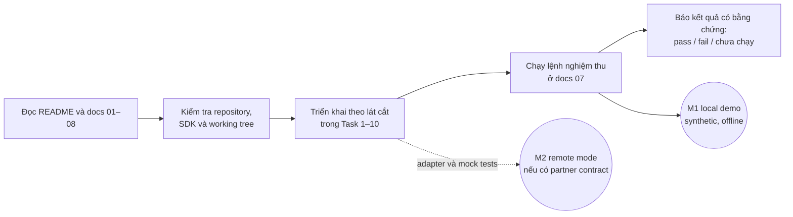

# 09. Prompt giao việc cho Gemini

## Luồng làm việc

Sơ đồ tóm tắt thứ tự giao việc; prompt bên dưới giữ các ràng buộc chi tiết và là phần cần sao chép cho Gemini.

Sao chép prompt bên dưới cho Gemini cùng thư mục 121-LabWorkflow.

~~~text
Bạn là engineer triển khai project 121-LabWorkflow trong repository D:\GitHub\dotnet-example.

Đọc đầy đủ theo thứ tự:
1. 121-LabWorkflow/README.md
2. 121-LabWorkflow/docs/01-product-requirements.md
3. 121-LabWorkflow/docs/02-domain-workflow.md
4. 121-LabWorkflow/docs/03-system-architecture.md
5. 121-LabWorkflow/docs/04-fhir-interoperability.md
6. 121-LabWorkflow/docs/05-api-ui-security.md
7. 121-LabWorkflow/docs/06-reliability-operations.md
8. 121-LabWorkflow/docs/07-testing-acceptance.md
9. 121-LabWorkflow/docs/08-implementation-plan.md

Hãy triển khai project theo Task 1 đến Task 10 trong implementation plan. Mục tiêu đầu tiên là M1: một showcase độc lập, chạy local bằng dữ liệu synthetic, hoàn tất order -> specimen -> result -> reviewer release -> durable outbox -> local FHIR simulator. Không cần quyền truy cập bệnh viện để hoàn thành M1.

Quy tắc bắt buộc:
- Target .NET 10 và dùng ASP.NET Core Controllers theo quy ước repo.
- Chỉ tạo/thay đổi file trong 121-LabWorkflow cho tới khi source và kiểm thử đã chạy; không sửa hoặc khôi phục các thay đổi đang có trong 120-Realtime-TaskBoard.
- Giữ Domain/Application độc lập với EF Core, ASP.NET và Firely SDK; dùng adapter mapping riêng cho FHIR.
- Mặc định chạy offline ở Demo mode. Không dùng patient data thật, không gọi public FHIR server, không gửi dữ liệu ra Internet.
- Không bịa mã LOINC/SNOMED/UCUM hoặc reference ranges. Fixture synthetic phải ghi rõ là giả và không dùng lâm sàng.
- Không tự diễn giải kết quả hoặc tạo cảnh báo/diagnosis.
- Chỉ phát hành FHIR DiagnosticReport sau khi Reviewer có quyền duyệt. Snapshot đã phát hành là immutable; correction tạo ReportRevision mới với reason bắt buộc.
- M1 mỗi upstream ServiceRequest ánh xạ đúng một LabCase và một chuỗi DiagnosticReport; unsupported compound order chuyển reconciliation, không tự tách case. Report đầu tiên gom đủ kết quả, không partial/multi-report. Bản đầu dùng status `final`; correction dùng `corrected` và version-aware update theo contract simulator.
- IncomingOrder là danh tính ổn định của ServiceRequest; lưu mọi observed version vào ImportedOrderVersions và nối tất cả về cùng LabCase. Duplicate version là no-op; version đổi sau khi lab nhận việc phải giữ cả hai snapshot và tạo reconciliation, không tạo case thứ hai.
- Bắt buộc lưu TestExecutionTime tách khỏi IssuedAt; map sang `DiagnosticReport.effective[x]` và `issued` tương ứng. Thiếu TestExecutionTime thì chặn release; không tự tạo thời gian hoặc thay bằng issued.
- Correction phải đi qua draft: LabTechnician submit full corrected snapshot + reason + base report revision + expected LabCase version; Reviewer khác author mới release. Chỉ cho tạo draft từ revision mới nhất đã Delivered/đối soát, một draft active/case. Correction giữ FHIR logical IDs/business identifiers, dùng If-Match/ETag, tăng meta.versionId và giữ history; stale ETag trả 412 rồi reconciliation, không retry mù.
- Pin `<LangVersion>13.0</LangVersion>` trong `Directory.Build.props` để project net10.0 theo đúng convention root repo.
- Lưu report revision + audit + outbox trong cùng transaction PostgreSQL. Dùng worker/outbox bền vững, idempotency, optimistic concurrency và reconciliation; không tuyên bố exactly-once.
- Không retry FHIR transaction POST vô điều kiện. Kiểm tra CapabilityStatement, profiles, auth scopes và conditional interactions trước Remote mode.
- Demo authentication chỉ bật trong Development + Demo mode; fail startup ngoài điều kiện đó. Không tự xây production identity provider.
- Không đưa secret, token, private key, patient identifier, raw FHIR payload hoặc result vào logs.
- Khi cần chọn package/version, tra tài liệu chính thức hiện hành và chọn bản stable tương thích .NET 10, EF Core 10 và FHIR R4. Commit lock files.
- Không commit, push, tạo PR hay cập nhật root README project count trừ khi được yêu cầu.

Thực hiện theo kế hoạch, không dừng sau khi tạo scaffold hoặc tài liệu. Hoàn tất M1 end-to-end, rồi implement Remote adapter theo mức có thể kiểm thử bằng mock HTTP. Nếu thiếu partner FHIR server/profile/credentials, để remote deployment chưa được xác nhận nhưng tiếp tục hoàn tất demo.

Khi kết thúc:
1. Chạy restore, Release build, toàn bộ .NET tests, frontend tests/build, compose config và E2E smoke theo docs/07-testing-acceptance.md.
2. Báo chính xác command nào pass/fail/chưa chạy; không khẳng định test pass nếu không có output.
3. Liệt kê các file chính đã tạo, các acceptance criteria đạt/chưa đạt, cấu hình cần thiết để chạy và giới hạn production.
4. Kiểm tra git status; giữ nguyên mọi thay đổi ngoài project 121.
~~~

