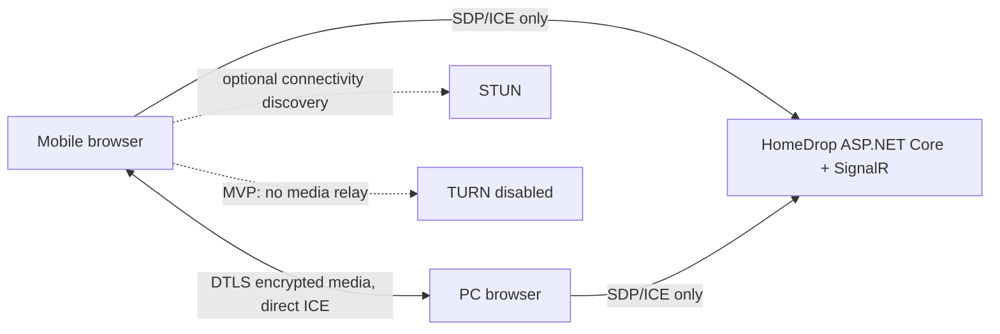

# 00 — Quyết định và phạm vi

## Mục tiêu

Cho người dùng gia đình chuyển video lớn giữa thiết bị bằng trình duyệt, không cài app, không tạo tài khoản. Mở HomeDrop trên hai thiết bị, quét QR, xác nhận gửi/nhận.

## Quyết định kiến trúc đã chốt

| ADR | Quyết định | Hệ quả |
|---|---|---|
| 01 | Web app responsive, ưu tiên phone → desktop; không WPF/MAUI/native client | Cả hai thiết bị chỉ cần browser hiện đại và URL HTTPS |
| 02 | ASP.NET Core .NET 10 host web/API + SignalR signaling trên cloud | Nhà phát triển vận hành domain, TLS, compute và giám sát dịch vụ |
| 03 | WebRTC DataChannel là data plane; video truyền peer-to-peer trực tiếp | Cloud không nhận hoặc lưu video trong MVP |
| 04 | Không có TURN relay trong MVP | Direct ICE thất bại thì báo không kết nối; không fallback upload ngầm |
| 05 | Ghép bằng QR invitation secret một lần; 10 phút để join; room active idle 30 phút/hard limit 72 giờ | Không có thiết bị tin cậy lâu dài hay account |
| 06 | Phạm vi beta: sender Android Chrome và iOS Safari; receiver desktop Chrome/Edge | Mobile nhận file và desktop gửi là thử nghiệm, chưa cam kết |
| 07 | Chunks 64 KiB, ACK theo byte offset đã ghi, backpressure qua bufferedAmount | Dùng chunk nhỏ để phù hợp giới hạn DataChannel khác nhau giữa browser |
| 08 | Không lưu bền vững video hay metadata cá nhân trên server | Signaling transient; log không chứa SDP/ICE/room secret/file name |
| 09 | Sender và receiver cùng tính SHA-256 streaming độc lập; receiver so final digest trước khi finalize | Không báo thành công chỉ dựa trên bytes ACK hoặc digest một phía |
| 10 | Nếu tab bị đóng, sender phải mở lại phiên và chọn lại file; resume trong cùng browser session là mục tiêu đầu tiên | Không quảng cáo tiếp tục hoàn toàn tự động sau khi browser bị kill |

## Bắt buộc phân biệt hai loại server

1. **Web/signaling service**: bắt buộc. Phục vụ HTML/JS/CSS qua HTTPS, tạo room ngắn hạn, chuyển SDP/ICE giữa hai client qua SignalR. Không proxy bytes video.
2. **STUN**: ICE có thể cần dịch vụ STUN công khai để khám phá địa chỉ candidate. STUN không vận chuyển file. Có thể vận hành Coturn hoặc dùng nhà cung cấp; quyết định nhà cung cấp, privacy, availability và chi phí phải ghi cấu hình triển khai.
3. **TURN**: relay media khi P2P không đi xuyên NAT. Không triển khai/bật trong MVP. Nếu bổ sung, TURN chuyển tiếp gói WebRTC được mã hóa nhưng sẽ mang lưu lượng video và tính phí băng thông đáng kể.

## Out of scope v1

- Native apps, account, permanent device pairing, cloud backup/share links.
- Silent cloud upload, cloud media storage, server-side transcoding or indexing.
- Guaranteed background transfer, mobile-to-mobile support, incoming file save on iOS.
- TURN fallback unless a separate cost/privacy decision is approved.
- More than one sender/receiver per room, public discovery, arbitrary file sharing beyond user-selected files.

## Rủi ro phải đóng trước khi cam kết sản phẩm

| Rủi ro | Cổng bắt buộc |
|---|---|
| Browser tab bị suspend / iOS đóng tab | Device spike gửi file lớn foreground trên iPhone và Android |
| Browser download/save UX không ghi stream ra đĩa | Chứng minh desktop nhận được file lớn không nhân đôi toàn bộ RAM; nếu không đạt, thu hẹp size/platform hoặc thiết kế TURN/storage có consent |
| NAT không tạo đường P2P | Đo tỷ lệ kết nối trong nhiều mạng; công bố unsupported; đánh giá TURN riêng |
| P2P có thể lộ IP peer qua ICE | Nêu rõ trong privacy notice; hạn chế log; đánh giá candidate policy |

Không thay ADR sang cloud relay hoặc native app để né spike mà không cập nhật toàn bộ tài liệu, UX, chi phí và consent.
