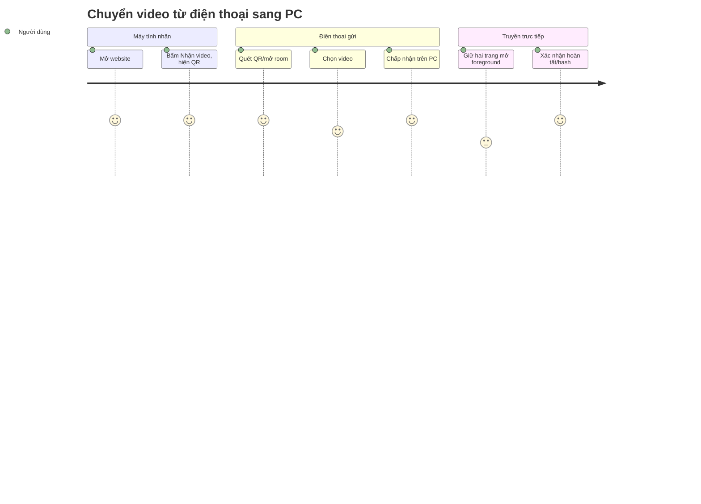

# 01 — Phân tích nhu cầu

## Người dùng / vấn đề

Người dùng phổ thông có video dung lượng lớn trên điện thoại và muốn chuyển sang máy tính gia đình mà không cài app, không cần đăng ký, không nén video qua ứng dụng chat. Nỗi đau cần giải quyết là thao tác ít: mở web, quét QR, chọn video, xác nhận nhận.

## Giá trị và giới hạn lời hứa

HomeDrop giảm số bước thiết lập và tránh giới hạn đính kèm ứng dụng chat. Chất lượng bản nhận bằng đúng bytes browser cấp cho trang. Không bảo đảm mọi loại metadata của thư viện Photos, không xóa source, không chạy nền, không bảo đảm P2P qua mọi mạng. Dữ liệu video không upload tới máy chủ HomeDrop trong MVP.

## Luồng người dùng chuẩn

## Yêu cầu chức năng

| ID | Yêu cầu |
|---|---|
| FR01 | Responsive web app qua HTTPS, dùng được không cần cài hoặc tạo account |
| FR02 | Receiver tạo room tạm và QR; invitation secret one-use, 10 phút để sender join; active transfer có idle timeout 30 phút và hard limit 72 giờ |
| FR03 | Sender chủ động chọn file video qua browser picker |
| FR04 | Receiver thấy tên/kích cỡ, có thể accept/reject trước payload |
| FR05 | Signaling qua ASP.NET Core SignalR; nội dung video chỉ qua WebRTC DataChannel P2P |
| FR06 | Nếu ICE trực tiếp thất bại, báo lỗi rõ; không upload/fallback relay âm thầm |
| FR07 | Chunks tuần tự, bounded memory/backpressure, offset ACK từ receiver |
| FR08 | So sánh kích thước và SHA-256 final do sender gửi với hash receiver tự tính trước Completed |
| FR09 | Hủy, timeout, disconnect và hướng dẫn thử lại có trạng thái dễ hiểu |
| FR10 | Không đăng nhập, không pairing lâu dài, không lưu media trên server |
| FR11 | Chỉ tuyên bố hỗ trợ browser/platform đã qua real-device spike |

## Yêu cầu phi chức năng và acceptance target

| ID | Yêu cầu |
|---|---|
| NFR01 | Origin HTTPS, CSP, security headers, dependency lock; không có third-party analytics đọc room URL |
| NFR02 | Chunks 64 KiB; sender pause khi bufferedAmount >1 MiB và resume dưới 256 KiB |
| NFR03 | Server invitation TTL 10 phút; active room idle timeout 30 phút/hard limit 72 giờ; max 2 peers, rate limits, payload limits |
| NFR04 | File lớn không được buffer đầy đủ trong RAM; chứng minh qua fixture tới mức dung lượng được claim |
| NFR05 | Server không ghi SDP/ICE/secret/file name/file content vào log |
| NFR06 | User cancellation và tab close không để UI báo Completed sai |
| NFR07 | Accessibility: keyboard desktop, screen reader labels, touch targets mobile, progress text |

## Ngoài phạm vi

Native app; account/library; cloud storage; share links; transfer background; mobile receive; multi-device broadcast; TURN relay; file preview/transcode; truyền nội bộ khi không có Internet từ lúc mở web.

## Rủi ro sản phẩm

Không có TURN đồng nghĩa có mạng P2P thất bại. Bất kỳ thêm relay nào phải nói rõ là media đi qua nhà cung cấp relay, cập nhật privacy/chi phí/consent và đo giá băng thông. Browser APIs không đồng đều nên khả năng lưu file dung lượng lớn là release gate chứ không giả định.
