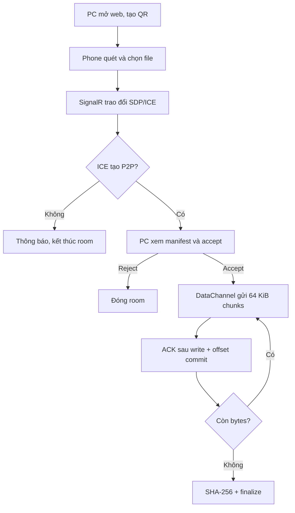

# 02 — Use case và phân rã chức năng

## Actors

- **Người gửi**: dùng browser mobile, chọn video và bắt đầu gửi.
- **Người nhận**: dùng browser desktop, tạo QR, xem chi tiết và chấp nhận/lưu file.
- **HomeDrop signaling service**: cấp trang và điều phối signaling; không phải actor nhận video.

## Use case chính UC01 — Chuyển phone → PC

**Tiền điều kiện:** cả hai thiết bị mở website HTTPS; có mạng tới signaling service; browser hỗ trợ WebRTC. **Kết quả:** PC có file trùng bytes đã gửi và hash khớp, hoặc UI giải thích lỗi; source trên phone không đổi.

1. Người nhận bấm Nhận video; server tạo QR invitation dùng một lần, sender phải join trong 10 phút.
2. Người gửi quét QR, vào room và chọn video bằng browser picker.
3. Browser trao đổi offer/answer và ICE qua SignalR; media chưa bắt đầu.
4. WebRTC DataChannel được thiết lập trực tiếp; receiver hiển thị tên/kích cỡ và yêu cầu consent.
5. Người nhận xem tên/kích cỡ, bấm “Chấp nhận và chọn nơi lưu”; gọi save picker ngay trong user gesture trước mọi thao tác bất đồng bộ dài.
6. Sender đọc File slice tuần tự, gửi chunks 64 KiB theo backpressure.
7. Receiver cập nhật hash trên các bytes đã ghi; sau chunk cuối sender gửi totalBytes + SHA-256 final, receiver so với hash độc lập rồi mới finalize và ACK file-verified.
8. Hai client đóng room; UI báo hoàn tất. Không xóa file nguồn.

**Luồng thay thế:** reject → xóa room; ICE fail → gợi ý cùng Wi-Fi/thử lại, không relay; disconnect → pause/reconcile nếu hai trang còn sống; browser tab mất source/storage state → chọn lại file hoặc bắt đầu lại; hash mismatch → không finalize và báo lỗi toàn vẹn.

## Phân rã chức năng

| Module | Trách nhiệm |
|---|---|
| Web UI | Landing, create/join room, scan/deep link, consent, save, progress, retry/error |
| Signaling | Room create/join/expiry, peer authorization, SDP/ICE exchange, rate limits |
| WebRTC transport | PeerConnection, DataChannel lifecycle, ICE status, bounded reconnect |
| File sender | Browser file picker, sequential slice, identity reconciliation |
| File receiver | Chunk validation, backpressure, write strategy adapter, ACK and hash |
| Storage adapter | Desktop File System Access API; fallback only after spike; no mobile receive MVP |
| Operations | Deploy, TLS, health, room counts, privacy-safe telemetry, abuse response |

## Business rules

- One receiver + one sender per room; one active transfer per room.
- Receiver consent is required after peer identity and file manifest are shown.
- Unjoined invitation expires after 10 minutes and can be consumed once; active room follows the separate idle/hard limits in docs 03–04.
- Server does not accept media payloads or expose upload endpoints.
- Receiver's committed offset is authoritative for same-page resume.
- Any actual TURN fallback is a distinct product/architecture decision requiring updated consent.
- v1 target flow is phone → desktop only.
