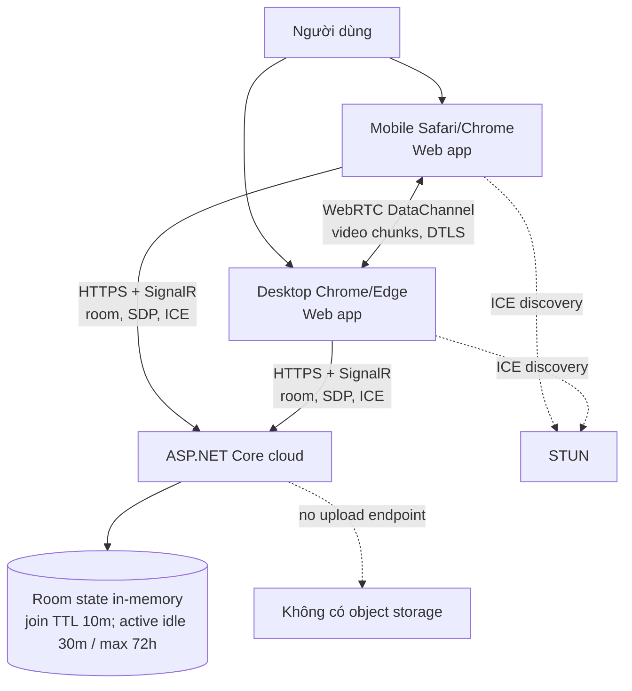
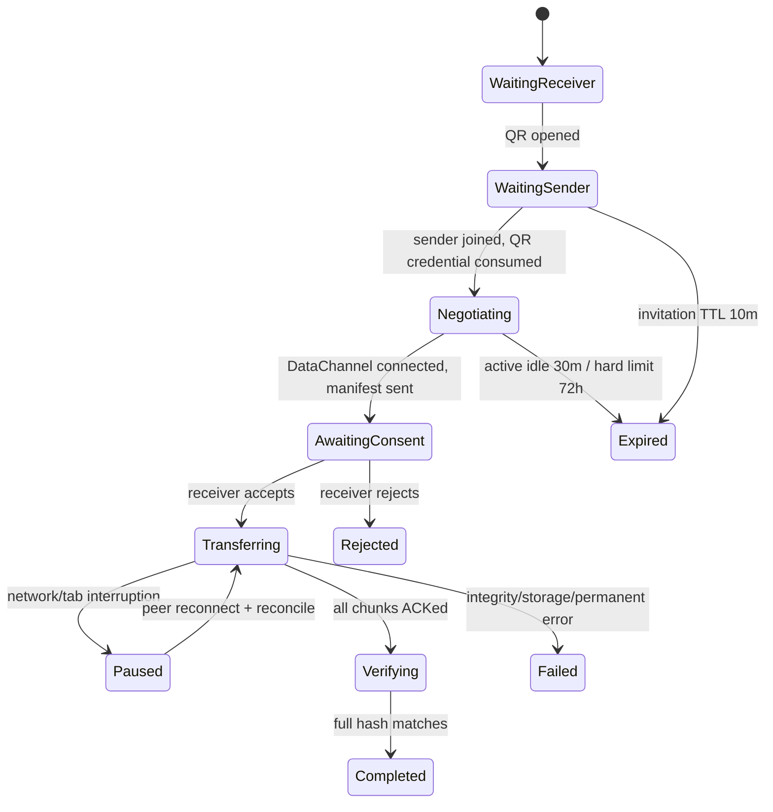

# 03 — Thiết kế hệ thống

## 1. Thành phần và vận hành

| Thành phần | Chạy ở đâu | Chức năng | Có thấy video? |
|---|---|---|---|
| Web client (TypeScript) | Browser trên phone/PC | UI, picker, WebRTC peer, chunk/hash/progress | Có, trên thiết bị người dùng |
| ASP.NET Core web host | Cloud do HomeDrop vận hành | Phục vụ app/static assets, health, rate limit | Không |
| SignalR room service | Cùng ASP.NET Core service | Tạo room/invitation TTL, relay SDP/ICE, peer credentials, heartbeat và cleanup | Không, chỉ signaling metadata |
| STUN service | Internet/provider | Khám phá ICE candidates | Không |
| TURN | Không có trong MVP | Không áp dụng | Không |



**Máy chủ cụ thể**: một web app ASP.NET Core .NET 10 (Razor/static hosting hoặc API + static asset) với SignalR Hub, chạy trên dịch vụ cloud/VPS sau HTTPS reverse proxy/load balancer. MVP một instance; room state in-memory chỉ hoạt động ổn định trên một instance. Nếu scale out, dùng backplane như Redis hoặc sticky sessions phù hợp, nhưng không cần trong MVP. Nhà vận hành chịu domain, chứng chỉ TLS, deploy, monitoring, abuse controls, STUN availability và chi phí compute. Không cần database/media bucket trong MVP.

## 2. Trust boundaries

- HTTPS origin bảo vệ việc tải trang/signaling. WebRTC DataChannel được bảo vệ DTLS giữa hai peer.
- Receiver hiển thị tên file/kích cỡ và phải bấm nhận trước khi chấp nhận DataChannel payload.
- Invitation secret ngẫu nhiên tối thiểu 128 bit; đưa vào QR/deep link fragment, không query string/log/referrer. One-use, hash trong state, chỉ mở room mới tối đa 10 phút; active room áp dụng idle/hard limits tại mục state.
- SDP/ICE có địa chỉ mạng nhạy cảm; gửi chỉ tới peer trong room, không lưu application logs/analytics.
- Mã trang bị compromise có thể đọc được file; CSP chặt, dependency lock, hạn chế script bên thứ ba, release assets immutable.

## 3. Luồng đầu cuối

```mermaid
sequenceDiagram
    actor P as Người dùng
    participant S as ASP.NET Core + SignalR
    participant A as Browser sender
    participant B as Browser receiver
    P->>B: Mở URL, tạo room, hiển thị QR
    B->>S: CreateRoom(roomSecretHash)
    P->>A: Quét QR và chọn file
    A->>S: JoinRoom(secret)
    A->>S: Offer SDP + ICE candidates
    S->>B: Chuyển offer/candidates
    B->>S: Answer SDP + ICE candidates
    S->>A: Chuyển answer/candidates
    A<-->B: ICE connectivity checks, chọn direct candidate pair
    B->>P: Xem manifest, bấm Chấp nhận
    A<->>B: DataChannel ready / accept
    loop Mỗi chunk 64 KiB có backpressure
        A->>B: Header + binary chunk
        B->>B: Verify chunk, ghi staging, flush, ACK offset
    end
    B->>B: SHA-256 toàn tệp, finalize/save
    B->>A: Complete receipt
    S->>S: Xóa room state
```

SignalR chỉ mở channel cho signaling. Khi P2P kết nối, file đi trên SCTP/DataChannel giữa browsers; ASP.NET không tham gia đường bytes. Server ghi tối thiểu counters tổng hợp, không lưu IP/SDP/ICE/file names dài hạn.

## 4. Cấu trúc solution đề xuất

```text
src/
  HomeDrop.Web/                 ASP.NET Core host, static hosting, SignalR, health
  HomeDrop.Signaling/           Room lifecycle, authorization, ephemeral state
  HomeDrop.Contracts/           Message DTOs, protocol version
  web/                          TypeScript UI, WebRTC transport, platform adapters
tests/
  HomeDrop.Signaling.Tests/
  HomeDrop.Web.IntegrationTests/
  web tests (unit + browser e2e)
deploy/
  Dockerfile, reverse-proxy example, environment template, runbook
```

Không bắt buộc dựng microservices, DB, queue hay Redis cho MVP. C# xử lý service, rate limits, room TTL và observability; browser xử lý file streaming. Nếu ASP.NET host SPA assets thì build pipeline đưa bundle vào `wwwroot`; không ép xử lý chunk/file qua API.

## 5. State và tính mở rộng

Room state: `roomId`, invitation secret hash, per-peer reconnect token hashes, SignalR connection IDs, `createdAt`, `joinExpiresAt`, `lastActivityAt`, state, protocolVersion. QR invitation hết hạn sau 10 phút nếu sender chưa join. Khi sender join thành công, invitation secret bị consume; room chuyển Active, không áp dụng QR TTL cho truyền file. Active room có idle timeout 30 phút khi không có peer và hard lifetime tối đa 72 giờ; heartbeat signaling mỗi 30 giây giữ room active trong khi DataChannel truyền media trực tiếp. Disconnect ngắn được giữ để reconnect. `complete/reject` xóa room ngay. Same-page reconnect dùng credential riêng gắn peer: cấp cho receiver khi tạo room và sender khi join, giữ trong memory client và server-side hash, rotate nguyên tử sau khi dùng; không tái sử dụng QR secret. Sau browser reload không hứa reconnect.



Scale-out cần sticky WebSocket connections hoặc SignalR backplane và shared expiring room state. Không scale out trước khi đo; mọi node vẫn chỉ điều phối metadata. TURN scale/cost là quyết định riêng vì chuyển thành media relay.

## 6. Khả năng, hiệu năng và failure modes

Không đưa cam kết throughput cho tới khi đo trên router/mạng và browsers thật. Telemetry client-side đề xuất: signaling success, ICE selected candidate type (host/srflx/relay), connection time, throughput, pause/resume, completed/hash result; consent rõ và không gửi filename/content. MVP không chấp nhận candidate relay (vì không có TURN credentials) và không fallback lên API.

| Lỗi | UI/hành vi |
|---|---|
| Signaling server không đến được | Báo không kết nối tới dịch vụ; retry tạo room mới |
| ICE không có candidate pair hoạt động | Báo mạng không hỗ trợ kết nối trực tiếp; gợi ý cùng Wi-Fi/thử lại |
| DataChannel rớt | Paused; giữ tab mở để thử reconnect bằng peer-scoped token; reconcile ACK offset |
| Sender tab bị đóng | Không đảm bảo resume; mở lại, scan room mới, chọn lại file |
| Receiver storage/download thất bại | Không ACK chunk chưa ghi; giữ phần đã commit nếu browser storage còn |
| Hash mismatch | Không finalize, báo thất bại toàn vẹn, cho phép gửi lại |
| Room service restart | Room mất; tạo QR/room mới |

## 7. Công nghệ và nguồn

.NET 10/C#13, ASP.NET Core, SignalR cho server; TypeScript + Web APIs (WebRTC, File/Blob, Streams, IndexedDB/OPFS nếu spike chứng minh) cho browser. Mọi API và browser behavior cần xác minh theo ma trận tài liệu 07. Tham khảo [ASP.NET Core SignalR hubs](https://learn.microsoft.com/en-us/aspnet/core/signalr/hubs?view=aspnetcore-10.0), [WebRTC protocols](https://developer.mozilla.org/en-US/docs/Web/API/WebRTC_API/Protocols), [RTCDataChannel](https://developer.mozilla.org/en-US/docs/Web/API/RTCDataChannel).
