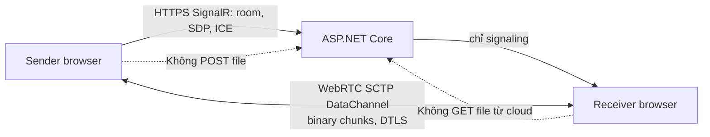
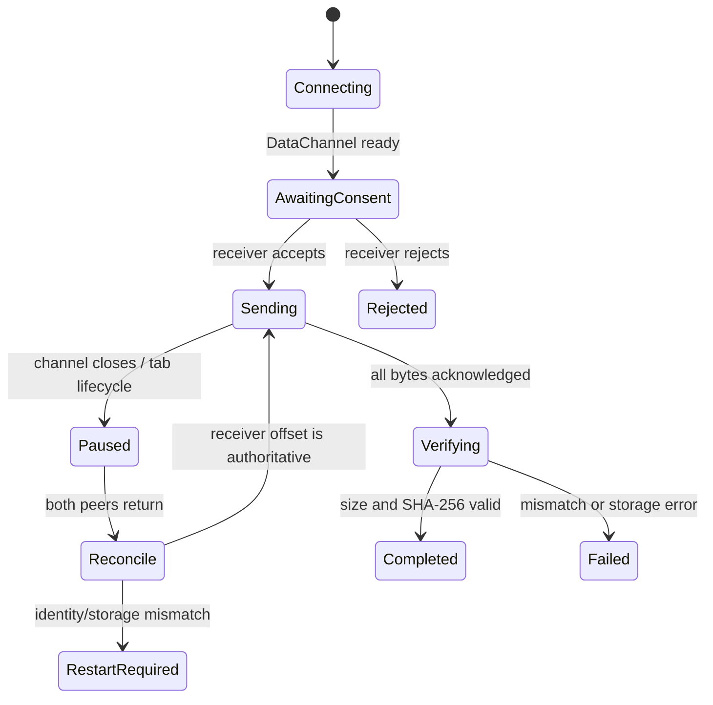

# 04 — Giao thức ghép nối và truyền file

## 1. Phân chia control plane / data plane



Control plane dùng HTTPS + SignalR. Data plane dùng WebRTC DataChannel với `ordered=true`, `maxRetransmits` mặc định (reliable). WebRTC DataChannel mã hóa bằng DTLS; DataChannel chịu giới hạn kích thước message theo browser nên protocol dùng chunks 64 KiB, không gửi nguyên file trong một message. Tham khảo [RTCDataChannel.send](https://developer.mozilla.org/en-US/docs/Web/API/RTCDataChannel/send) và [Using WebRTC data channels](https://developer.mozilla.org/en-US/docs/Web/API/WebRTC_API/Using_data_channels).

## 2. Ghép nối QR

Receiver bấm “Nhận video” → server tạo `roomId` + invitation secret CSPRNG 128 bit. Khi chưa có sender, invitation hết hạn sau 10 phút. QR chứa `https://homedrop.example/r#<roomId>.<secret>`. Fragment không được gửi trong HTTP request/referrer theo quy ước URL, nhưng client phải tránh ghi URL đầy đủ vào analytics/error logs. Invitation secret one-use; server consume khi sender join. Sau join room chuyển Active và invitation TTL không còn áp dụng. Complete/reject xóa room; room active có idle timeout 30 phút và hard limit 72 giờ. Rate limit theo IP, room và connection.

SignalR event contract:

| Event | Từ → đến | Nội dung |
|---|---|---|
| `CreateRoom` | Receiver → server | protocolVersion; trả roomId, joinExpiresAt, invitationSecret, receiverPeerId, receiverReconnectToken |
| `JoinRoom` | Sender → server | roomId, invitationSecret, protocolVersion; trả senderPeerId, senderReconnectToken |
| `ReconnectRoom` | Peer → server | roomId, peerId, currentReconnectToken; on success returns rotatedReconnectToken |
| `KeepAlive` | Peer → server | roomId, peerId, valid peer credential; updates lastActivityAt at 30-second cadence |
| `PeerJoined` | Server → receiver | sender đã vào room |
| `RelayDescription` | Peer → peer qua server | SDP offer/answer; chỉ room member |
| `RelayCandidate` | Peer → peer qua server | ICE candidate |
| `RoomReady` | Server → peers | trạng thái join/negotiation |
| `RejectRoom` / `CloseRoom` | Receiver/peer → server | kết thúc room |
| `RoomError` | Server → peer | code chuẩn, không stack trace |

Receiver nhận peer-scoped reconnect token ngay từ `CreateRoom`; sender nhận token từ `JoinRoom`. Server cấp token riêng 128-bit cho từng peer, chỉ lưu hash; `ReconnectRoom` xác thực token hiện tại rồi rotate nguyên tử và trả token mới cho đúng peer. Client giữ token chỉ trong memory trang; token hết hạn khi room đóng hoặc peer disconnected/room idle timeout. Token không phải invitation secret, không hiện trong URL/QR/log. Reload làm mất token; UI xin tạo room mới thay vì hứa resume. Mỗi client tự tạo `RTCPeerConnection`, cấu hình ICE servers từ deploy config, tạo offer/answer và trickle ICE candidates. UI hiển thị trạng thái kết nối trực tiếp; ICE timeout 20 giây, retry một lần; nếu thất bại thì dừng, không chuyển đường truyền lên HTTP. MVP không cấp TURN credential.

## 3. Consent và manifest

Sender chọn file(s) qua `<input type=file>` hoặc file picker phù hợp, giới hạn v1 theo spike: khuyến nghị một file/transfer, tối đa dung lượng được cấu hình và công bố. Tên hiển thị, size, type chỉ là metadata không tin cậy. Sender gửi JSON manifest qua DataChannel; receiver xem tên/kích cỡ và chấp nhận hoặc từ chối trước khi nhận payload.

```json
{
  "type": "manifest",
  "protocolVersion": 1,
  "transferId": "opaque-random-id",
  "files": [{
    "fileId": "opaque-random-id",
    "name": "family-video.mov",
    "sizeBytes": 5368709120,
    "mimeType": "video/quicktime",
    "lastModified": 0
  }]
}
```

Không hash toàn source trước khi gửi vì tăng thời gian chờ; sender cập nhật SHA-256 streaming trên các bytes của chunk chỉ sau khi nhận ACK cho offset tương ứng. Receiver cập nhật hash trên bytes đã ghi/commit. Sau ACK chunk cuối sender gửi `file-end` gồm totalBytes và digest; receiver so hash độc lập trước finalize. Sender tuyệt đối không đưa bytes chưa ACK vào hash state authoritative. Khi resume, receiver offset là nguồn sự thật: nếu sender hash state đang đúng tới offset đó thì tiếp tục; nếu ACK bị mất hoặc hai offset lệch, sender tạo lại SHA-256 state bằng cách đọc lại source `File.slice(0, committedBytes)` tuần tự một chunk tại một thời điểm, rồi mới gửi phần còn lại. Cách này tránh double-hash khi receiver đã commit nhưng ACK bị mất. Sau reload cần chọn lại file và hash prefix đã commit để xác thực tiếp tục; size/mtime đơn thuần không đủ. Mọi hash đều xử lý theo chunk, không materialize cả file trong RAM.

```json
{"type":"file-end","fileId":"opaque-random-id","totalBytes":5368709120,"sha256":"<64 lowercase hex chars>"}
```

Receiver trả `file-verified` với size/hash đã tính độc lập khi khớp; mismatch trả `HASH_MISMATCH`, không finalize và xóa/cancel staging theo khả năng storage adapter.

## 4. Binary frame, chunks và backpressure

DataChannel gửi header JSON frame riêng, kế tiếp một binary message chứa đúng một chunk; ordered channel giữ thứ tự. `chunkSize=65536`, sequence bắt đầu từ 0. Protocol version 1 không nén/chuyển mã.

```json
{"type":"chunk","fileId":"...","sequence":12,"offset":786432,"length":65536}
```

Receiver chỉ accept `offset == committedBytes`, `length == min(65536, fileSize-offset)`. Tính SHA-256 per chunk để phát hiện lỗi nội bộ, ghi staging, flush theo mức bền vững của adapter, sau đó cập nhật `committedBytes` và gửi ACK. ACK:

```json
{"type":"ack","fileId":"...","committedBytes":851968,"sequence":12}
```

Không để buffer vô hạn: sender dừng enqueue khi `dataChannel.bufferedAmount` vượt 1 MiB; resume dưới `bufferedAmountLowThreshold=256 KiB`. Chỉ gửi một chunk đang chờ ACK tại một thời điểm ở MVP. Receiver không ACK bytes chỉ còn trong RAM. Nếu storage API không cho durable append, chỉ cam kết resume trong page lifetime; phải ghi rõ trong UX.

## 5. Receiver lưu file — cổng kỹ thuật

Trước khi triển khai transfer lớn, spike riêng ba browser strategies:

1. Desktop Chromium: File System Access API `showSaveFilePicker()` gọi trực tiếp từ thao tác bấm của người dùng trước khi truyền bắt đầu, writable stream ghi dần.
2. Browser fallback: OPFS staging + hoàn tất download; đánh giá cần dung lượng gần gấp đôi file và browser quotas/eviction.
3. Safari/iOS: browser storage quota, tab lifecycle, khả năng nhận và export; chưa cam kết mobile receiver.

`showSaveFilePicker()` không được hỗ trợ rộng như Baseline và yêu cầu secure context/user activation. Vì activation có hạn, gọi picker ngay trong handler của nút “Nhận video”, sau khi user xem manifest và xác nhận nhưng trước khi chờ async signaling/network; giữ writable handle và nếu kết nối fail thì đóng/cancel an toàn. Không chờ đến khi file đã nhận mới bật picker. Không tạo Blob toàn file trong RAM. Nếu không có bounded-memory write strategy trên browser mục tiêu, dừng phát hành tính năng transfer nhiều GB cho browser đó. Tham khảo [File System API](https://developer.mozilla.org/en-US/docs/Web/API/File_System_API), [showSaveFilePicker](https://developer.mozilla.org/en-US/docs/Web/API/Window/showSaveFilePicker), [WebKit OPFS](https://webkit.org/blog/12257/the-file-system-access-api-with-origin-private-file-system/).

## 6. Resume và lỗi

Resume trong tab còn sống: hai peer trao đổi trạng thái `fileSize`, `committedBytes`, `transferId`; receiver là nguồn sự thật. Sender seek bằng `File.slice(offset)`; gửi lại từ offset ACK. Mismatch/receiver storage mất thì cancel/restart với consent mới. Khi tab sender đóng hoặc browser kill, File handle có thể mất quyền; UI phải yêu cầu người dùng chọn lại file, sau đó đối chiếu kích thước và hash. Không đảm bảo silent resume qua reload.



Codes: `ROOM_EXPIRED`, `ROOM_IN_USE`, `ICE_FAILED`, `PEER_DISCONNECTED`, `CONSENT_REJECTED`, `FILE_TOO_LARGE`, `STORAGE_UNAVAILABLE`, `OFFSET_MISMATCH`, `FILE_IDENTITY_MISMATCH`, `HASH_MISMATCH`, `PROTOCOL_MISMATCH`. Errors never include secret, SDP, ICE candidate, file path or contents. Network disconnect: pause; while page state and peer token remain, reconnect via `ReconnectRoom`, renegotiate ICE, reconcile receiver ACK offset, and resume. Idle cleanup after 30 minutes or hard room limit ends session. If page reload loses token/state or room expired, create a new room and repeat consent; do not promise resume after reload. The initial 10-minute QR invitation deadline never terminates an active transfer.

## 7. Server contract and limits

ASP.NET Core SignalR enforces one sender/receiver per room, strict DTO size limits, 10-minute invitation TTL, active room idle timeout 30 minutes, hard lifetime 72 hours, max 2 peers, peer-scoped rotating reconnect tokens, per-IP and per-room rate limits, maximum simultaneous rooms based on capacity, allowed origins, WebSocket/long-poll fallback policy. It rejects arbitrary client-provided URLs/callbacks. The service does not expose file upload/download endpoints. Redis/backplane not required for single-node MVP; multi-node deployment requires shared ephemeral room coordination and SignalR scale-out before routing users across nodes.

The signaling server's traffic scales with sessions/candidates, not video size. STUN is separately configured. TURN is excluded; adding TURN changes data-flow/privacy/cost and requires explicit product decision and consent copy.
