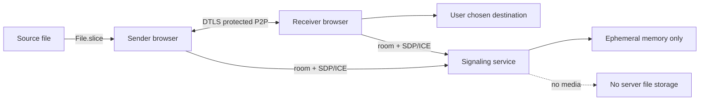

# 05 — Dữ liệu, riêng tư và bảo mật

## Data inventory

| Data | Nơi xử lý | Retention |
|---|---|---|
| Video bytes | Chỉ browser sender/receiver qua WebRTC DataChannel | Theo người dùng; app không upload lên cloud |
| Room ID + invitation/reconnect token hashes + peer IDs | Signaling service memory | Unjoined invitation: 10 phút; active room: idle 30 phút, hard limit 72 giờ; xóa khi complete/reject/expiry |
| SDP/ICE | SignalR transient relay | Chỉ trong lúc negotiation; không ghi log/DB |
| File name/size | Hai browser | Không gửi analytics/server logs |
| Operational metrics | Server/client aggregate opt-in | Không gồm IP/SDP/filename/secret/content |
| Receiver partial data | Browser-selected destination/storage | Theo browser quota/lifecycle; UI nêu rõ giới hạn và cho hủy |

## Threats and controls

| Threat | Control |
|---|---|
| Guessed/replayed room secret | CSPRNG 128-bit, one-use, hash in memory, TTL, rate limits |
| Unauthorized peer joins | Secret + room binding + only two connections + explicit receiver consent |
| Cross-site WebSocket abuse | Exact origin allowlist, HTTPS/WSS, anti-abuse limits, CSRF/origin validation |
| Malicious filename/path | Browser treats name as suggestion; use save picker, never concatenate into server filesystem path |
| Malformed frames / oversized messages | Strict JSON schema, type/length/offset checks, 64 KiB payload cap, close protocol-violating peer |
| Compromised website bundle | CSP, no inline eval, minimal dependencies, locked builds, SRI where applicable, deploy review |
| Peer IP disclosure through ICE | Explain direct connectivity privacy; avoid logging candidates; evaluate mDNS host candidates/browser behavior |
| Misleading “server never sees data” claim | State app server doesn't receive video; peer sees data; TURN (if later added) relays encrypted media |
| Denial of service on signaling | Per-IP/room limits, room cap, message size and connection limits, WAF/proxy protections |

## Security rules for implementation

- HTTPS-only, HSTS, CSP, `X-Content-Type-Options`, `Referrer-Policy: no-referrer`, restrictive Permissions Policy.
- Room secret goes in URL fragment or QR payload and must be scrubbed from UI/history after join. Never put secret in query string or telemetry.
- Validate `Origin`, allowed host, room membership, protocol version and state on every signaling event.
- Do not render filename with `innerHTML`; text-only output and browser save APIs.
- No arbitrary URL fetch, remote file import or server-side file proxy.
- Log event codes and aggregate duration only. Redact SignalR payloads; disable verbose protocol logs in production.
- Explain consent and direct peer connection before sending. Allow cancel at any time.
- External security review before public launch; abuse report/contact and deploy rollback procedure.

## Privacy/product copy

“HomeDrop’s service helps your devices connect. When direct transfer works, your video moves between the two devices and is not uploaded to HomeDrop. Your network/browser may reveal connection metadata such as IP addresses to the other peer. HomeDrop does not promise that transfer continues after a browser tab closes.”

If TURN is later enabled, replace the copy with explicit disclosure that encrypted transfer traffic can pass through a relay provider, specify retention (ideally none), provider, region and cost controls. DTLS encryption does not mean the relay carries no traffic.
