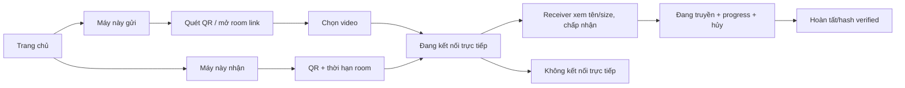

# 06 — Thiết kế giao diện

## Nguyên tắc

Mở URL là dùng ngay; hai vai trò được phân biệt rõ. Một hành động chính mỗi màn hình. Luôn nói “kết nối trực tiếp giữa thiết bị” và “không gửi video lên HomeDrop” đúng với MVP. Không hứa app chạy nền.

## Screen flow

## Screens and copy

| Screen | Content / action |
|---|---|
| Home | “Chuyển video giữa điện thoại và máy tính”; nút “Nhận trên máy này”, “Gửi từ máy này”; note cần Internet để kết nối |
| Receiver room | QR lớn, nút copy link, “Mở HomeDrop trên điện thoại và quét mã”; countdown 10 phút; không yêu cầu giữ screen awake |
| Sender join | Confirm room, privacy copy; chọn video button; allowed types hint; file size shown |
| Connecting | Stepper “Đang ghép nối → Đang tạo kết nối trực tiếp”; troubleshooting: cùng Wi-Fi, tắt VPN thử lại |
| Consent on receiver | Filename, file size, source peer label “Thiết bị vừa quét QR”; buttons “Nhận video” and “Từ chối”; explain bytes go device-to-device |
| Transfer | Progress from ACKed bytes, speed, elapsed time, pause/interruption state, cancel |
| Complete | “Video đã nhận và kiểm tra”; filename/size; “Mở thư mục” only when browser/platform grants; otherwise say saved/downloaded |
| Error | Plain-language cause + retry action; no internal ICE/SDP jargon |

## Accessibility/responsive

- QR has copy-link alternate and accessible label; scanning app/browser limitation must be tested, user can use same-device open link only if recipient device can access.
- Status updates via `aria-live=polite`, throttled to avoid announcing every chunk.
- Progress includes numeric bytes/percent and screen-reader text.
- Keyboard operable desktop, visible focus, 44px touch targets, contrast AA.
- Do not use color alone for connection/success/error state.
- On small phone, picker button and selected filename wrap; prevent horizontal scrolling.

## Prototype implementation note

`assets/ui-preview.html` is a static responsive mock of the browser flow. QR and progress are explicitly simulated; it does not connect to signaling or transfer a file. Keep that label until it actually uses WebRTC; mock progress must never imply a real connection.
