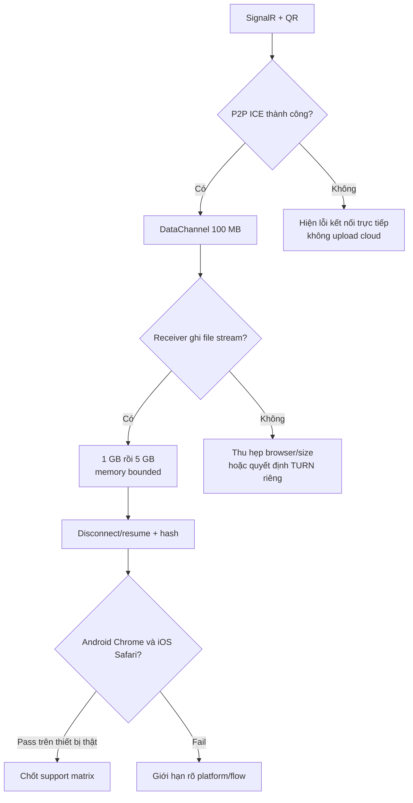

# 07 — Khả thi nền tảng và spike bắt buộc

## Browser matrix mục tiêu

| Vai trò | Browser ưu tiên | Mức cam kết trước spike |
|---|---|---|
| Gửi từ Android | Chrome Android mới | Mục tiêu beta; chọn local video và giữ tab foreground |
| Gửi từ iPhone | Safari iOS mới | Thử nghiệm bắt buộc trên thiết bị thật, chưa quảng cáo trước khi pass |
| Nhận trên Windows/macOS | Chrome/Edge desktop | Ưu tiên; phải chứng minh ghi file lớn không buffer toàn bộ RAM |
| Nhận trên iOS/Android | Không thuộc MVP | Không hứa lưu video lớn trong browser mobile |
| Firefox/Safari desktop | Best effort | Hỗ trợ sau khi kiểm tra DataChannel và save strategy |

## Giới hạn/điều kiện kỹ thuật

- WebRTC DataChannel truyền binary P2P; chunk 64 KiB và bounded backpressure để tránh message quá lớn/RAM tăng theo file.
- WebRTC connectivity có thể cần STUN; NAT/firewall có thể khiến direct P2P thất bại. MVP không dùng TURN. Tỷ lệ kết nối phải được đo trên các mạng thật.
- Site phải HTTPS; secure context cần cho WebRTC/file APIs.
- `showSaveFilePicker()` có availability hạn chế và cần user activation. Cần fallback được chứng minh hoặc giới hạn browser đích.
- OPFS/IndexedDB có quota và eviction policy; không coi dung lượng quota là cam kết cho video hàng chục GB.
- Tab mobile có thể suspend/terminate; không cam kết background transfer hay resume sau khi browser kill.
- Website không thể quét tự động toàn Photos library; user chủ động chọn qua browser picker.

## Spike M0 trước phát triển sản phẩm

1. ASP.NET Core SignalR trên HTTPS cục bộ/preview: room, QR, SDP/ICE, expiration, không persist.
2. Phone Android Chrome ↔ desktop Chrome, rồi iPhone Safari ↔ desktop Chrome: gửi 100 MB, 1 GB và 5 GB file fixture; ghi kết quả connection, throughput và disconnect.
3. Desktop receiver: ghi dần ra file bằng API picker; xác minh hash ngoài browser; đo process memory và tránh Blob full-file.
4. Bẻ Wi-Fi giữa các chunks: xác định DataChannel close/reconnect behavior, offset ACK, resume trong page sống.
5. Background/lock-screen thử nghiệm mô tả rõ như giới hạn; không thiết kế dựa vào service worker để chạy P2P vô hạn.
6. ICE direct failure matrix (same Wi-Fi, guest Wi-Fi, mobile data, symmetric NAT/VPN). Xác nhận không có HTTP media fallback.

## Nguồn kỹ thuật

- [MDN WebRTC connectivity](https://developer.mozilla.org/en-US/docs/Web/API/WebRTC_API/Connectivity)
- [MDN DataChannel send](https://developer.mozilla.org/en-US/docs/Web/API/RTCDataChannel/send)
- [MDN File System API](https://developer.mozilla.org/en-US/docs/Web/API/File_System_API)
- [MDN showSaveFilePicker](https://developer.mozilla.org/en-US/docs/Web/API/Window/showSaveFilePicker)
- [WebKit Origin Private File System](https://webkit.org/blog/12257/the-file-system-access-api-with-origin-private-file-system/)
- [WebKit storage policy](https://webkit.org/blog/14403/updates-to-storage-policy/)

Các trang API mô tả capability, không chứng minh UX/hiệu năng cho HomeDrop. Kết quả device spike là bằng chứng quyết định.
