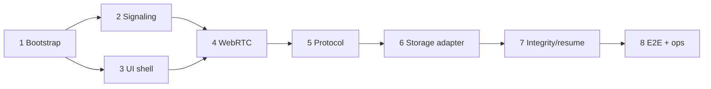

# 08 — Kế hoạch triển khai

## Các phase

| Phase | Nội dung | Exit criteria |
|---|---|---|
| M0 Feasibility | Spike SignalR room, WebRTC, QR, desktop save streaming, phone browser | Android Chrome ↔ desktop Chrome transfer 100 MB, checksum pass; ICE failure behavior known |
| M1 Thin vertical slice | .NET 10 host, TypeScript page, create/join, direct 10 MB transfer | E2E actual bytes; server receives no payload |
| M2 Safe transfer | 64 KiB framing, ACK, backpressure, hash, cancel, protocol errors | No whole-file RAM; exact hash; malformed frames rejected |
| M3 Large transfer/reconnect | Browser save adapter, file sizes per evidence, same-page resume/reconcile | 1 GB then larger fixture, memory bounded, interrupted transfer understandable |
| M4 Product polish | Responsive UX, accessibility, privacy copy, room limits, telemetry, support matrix | User flow and operational runbook reviewed |
| M5 Public beta | Deploy TLS, security review, device matrix, incident/rollback | Release gates in doc 09 satisfied |

## Work packages / ownership boundaries

1. **Repo/bootstrap:** ASP.NET Core web host + TypeScript frontend, local HTTPS instructions, locked dependencies.
2. **Signaling service:** SignalR room lifecycle, 128-bit secret, hash, expiry, state machine, origin/rate limits.
3. **Web UI:** home, receiver QR, sender join/picker, consent, progress, completion/error; responsive/accessibility.
4. **WebRTC transport:** offer/answer/trickle ICE, connection-state UX, explicit no-TURN policy.
5. **Protocol:** strict manifest/frame schemas, 64 KiB chunk, bounded queue, ACK authoritative offset.
6. **Storage adapters:** receiver desktop streaming save picker; feature detection and unsupported fallback UX.
7. **Integrity/recovery:** incremental chunk and final SHA-256; same-page resume; reselect after reload.
8. **Quality/ops:** unit/integration/browser E2E, device matrix, privacy-safe metrics, deploy/runbook/security.

## Dependency diagram

## Definition of done per package

- Acceptance criteria and failure path implemented, not only happy path.
- Unit tests for server state/protocol validators; browser tests for UX branches; real browser test for actual WebRTC.
- No user secrets or file metadata in logs.
- Docs, ADR and UI copy match actual media path.
- Collect evidence, browser/OS/version, network type, file size, bytes/hash, memory and ICE result.

Do not build account, database, admin portal, Redis/backplane, TURN or cloud upload as “future-proofing” in MVP. Revisit only after product evidence.
