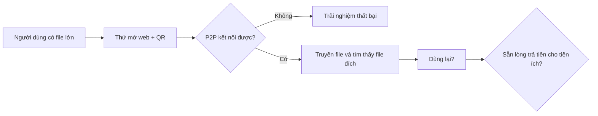

# 10 — Phân tích ứng dụng và kinh doanh

## Giả thuyết giá trị

HomeDrop giúp chuyển video lớn giữa điện thoại và máy tính bằng vài thao tác từ browser, không cài app, không tài khoản, không upload video lên HomeDrop. Khác biệt cần kiểm chứng là sự tiện khi quét QR và privacy của chuyển trực tiếp. Người dùng đã có thể dùng cáp, LocalSend, Telegram/Messenger hoặc cloud, vì vậy HomeDrop chưa có lợi thế mặc định.

## Rủi ro thương mại lớn nhất

1. Direct P2P không hoạt động trên mọi NAT/VPN/firewall; không có TURN làm giảm tỷ lệ hoàn tất.
2. Người dùng phải mở website trên hai thiết bị và giữ trang hoạt động trong lúc gửi.
3. Browser save APIs không đồng đều; giới hạn dung lượng và độ bền resume có thể yếu hơn app native.
4. Signaling host/STUN có chi phí và cần vận hành, dù video không qua server HomeDrop.
5. Tần suất chuyển video lớn có thể thấp nên mua một lần/thuê bao khó tạo doanh thu lặp lại.

## Cạnh tranh và cách đánh giá

So sánh trực tiếp với LocalSend, cáp/OS sharing, cloud drive, Messenger/Telegram bằng tác vụ thật: thời gian từ mở tới chọn file, số thao tác, thành công với file 1–5 GB, resume, nơi lưu, lượng dữ liệu cần qua Internet. Không khẳng định nhanh hơn/an toàn hơn/đơn giản hơn cho tới khi đo. HomeDrop không nên định vị chỉ bằng “gửi file”; định vị thử là “mở web, quét QR, truyền trực tiếp, không cần cài”.

## Chi phí vận hành

| Hạng mục | MVP |
|---|---|
| ASP.NET Core web/signaling | Một instance cloud/VPS, domain, HTTPS, monitoring |
| Room state | In-memory, TTL; không cần DB cho single instance |
| STUN | Public provider hoặc tự vận hành; đánh giá privacy/availability |
| Bandwidth video | Không phát sinh egress video từ HomeDrop nếu P2P trực tiếp thành công |
| TURN | Không bật; nếu thêm sẽ tạo chi phí theo GB và thay đổi privacy/data flow |
| Support | NAT failure, iOS/browser compatibility, thiết bị và browser lifecycle |

Chi phí thực phụ thuộc cloud, region, traffic signaling, STUN, logging/monitoring và hỗ trợ. Không đưa forecast doanh thu trước khi có dữ liệu retention/conversion.

## Thử nghiệm monetization

- Beta core miễn phí; đo tỷ lệ mở QR → P2P connected → accepted → completed, lỗi theo browser/network, số người quay lại.
- Phỏng vấn tối thiểu 10 người có video lớn và thử trên thiết bị họ; không thu file cá nhân.
- Chỉ thử trả tiền khi có use lặp lại. Thử one-time unlock cho tiện ích UX như nhiều transfer/history; không khóa hash integrity, consent hay an toàn.
- Định giá thử bằng phỏng vấn/checkout thật, không suy luận doanh thu từ lượt tải.
- Nếu P2P completion rate hoặc repeat use thấp, pivot/đóng dự án trước khi đầu tư TURN, vì TURN biến thành dịch vụ relay có chi phí theo dung lượng.

## Go / no-go đề xuất

**Go beta** nếu user mở web hiểu luồng, P2P thành công trên ma trận mạng mục tiêu, transfer file lớn có hash chính xác và không cần hỗ trợ thủ công. **Go monetization** chỉ khi có tỷ lệ dùng lại và willingness-to-pay thực. **No-go hoặc thu hẹp scope** nếu phải cài native app để đạt trải nghiệm cốt lõi, browser không ghi file lớn bounded-memory, hoặc đa số mạng cần TURN nhưng economics chưa hợp lý.
