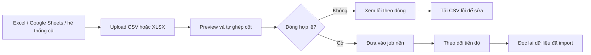

# 123-ImportStudio: Nhập dữ liệu hàng loạt có kiểm tra lỗi

## Vì sao cần ứng dụng này?

Người dùng không ngồi soạn CSV bằng tay. File thường được xuất từ Excel, Google Sheets, phần mềm bán hàng hoặc hệ thống cũ. Vấn đề thật sự bắt đầu khi một file có vài nghìn dòng và người vận hành phải:

- kiểm tra trước xem cột có đúng tên và dữ liệu có đủ hay chưa;
- tìm đúng dòng lỗi thay vì import xong rồi phát hiện dữ liệu hỏng;
- xử lý file lâu mà không phải giữ trình duyệt chờ;
- tải danh sách lỗi về để sửa ở Excel rồi gửi lại.

`ImportStudio` là API mẫu giải quyết đúng chuỗi công việc đó. Nó nhận cả **CSV và Excel `.xlsx`**, tự nhận diện các tên cột phổ biến, cho xem trước kết quả, tách dòng hợp lệ và dòng lỗi, rồi chạy job import nền.

## Luồng sử dụng



Ví dụ, file này đều được chấp nhận:

```csv
Name,Phone,Email
Nguyen An,0900000000,an@example.com
Tran Binh,0911111111,binh@example.com
```

Excel có thể dùng các tiêu đề tương đương như `Full Name`, `Customer Name`, `Phone Number` và `Email Address`. Bộ parser cũng bỏ dấu tiếng Việt khi so khớp, nên `Họ tên` và `Ho Ten` được nhận diện như nhau.

## API chính

| Method | Endpoint | Mục đích |
|---|---|---|
| `POST` | `/api/imports/preview` | Upload file multipart, đọc header, kiểm tra từng dòng và tạo job preview |
| `POST` | `/api/imports/{id}/start` | Đưa job vào `Channel<Guid>` để `BackgroundService` xử lý nền |
| `GET` | `/api/imports/{id}` | Xem trạng thái, tổng dòng, số đã xử lý, số import và số bị loại |
| `GET` | `/api/imports/{id}/customers` | Xem các customer hợp lệ đã import trong job |
| `GET` | `/api/imports/{id}/errors` | Xem lỗi có số dòng và tên cột |
| `GET` | `/api/imports/{id}/errors.csv` | Tải lỗi thành CSV để mở bằng Excel và sửa |

`POST /preview` không làm mất các dòng hợp lệ khi một dòng khác bị lỗi. Một dòng chỉ được đưa vào kết quả import nếu có họ tên, số điện thoại hợp lệ và email (nếu có) chứa `@`.

## Cấu trúc dự án

```text
123-ImportStudio/
├── ImportStudio.slnx
├── README.md
├── ImportStudio.Api/
│   ├── Controllers/ImportsController.cs
│   ├── Models/CustomerImportModels.cs
│   ├── Models/ImportJobModels.cs
│   ├── Services/CustomerImportParser.cs
│   ├── Services/ImportJobProcessor.cs
│   ├── Services/ImportJobQueue.cs
│   ├── Services/ImportJobStore.cs
│   ├── Services/ImportJobWorker.cs
│   └── ImportStudio.Api.http
└── ImportStudio.Tests/
    ├── CustomerImportParserTests.cs
    └── ImportJobProcessorTests.cs
```

- `CustomerImportParser` dùng CsvHelper cho CSV và ClosedXML cho XLSX.
- `ImportJobQueue` + `ImportJobWorker` minh họa producer/consumer bằng `System.Threading.Channels` và `BackgroundService`.
- `ImportJobStore` hiện là in-memory để project chạy ngay, không cần dựng database.
- Dữ liệu import chỉ sống trong tiến trình. Khi làm sản phẩm thật, thay store bằng EF Core/SQL và lưu file ở object storage; contract API và luồng preview vẫn giữ nguyên.

## Chạy thử

```powershell
cd 123-ImportStudio
dotnet run --project .\ImportStudio.Api
```

Mở Swagger tại [http://localhost:5159/swagger](http://localhost:5159/swagger). Có thể mở `ImportStudio.Api/ImportStudio.Api.http` trong Visual Studio, Rider hoặc VS Code REST Client.

Thứ tự gọi:

1. `POST /api/imports/preview` với form field tên `file`.
2. Lấy `id` từ response và gọi `POST /api/imports/{id}/start`.
3. Poll `GET /api/imports/{id}` đến khi `Completed`.
4. Đọc `/customers` hoặc tải `/errors.csv` nếu có dòng bị loại.

## Kiểm thử

```powershell
dotnet test .\ImportStudio.slnx
dotnet build .\ImportStudio.slnx -c Release --no-restore
```

Các test hiện có kiểm tra:

- đọc CSV và tự ghép các tên header phổ biến;
- đọc XLSX được tạo trực tiếp bằng ClosedXML;
- giữ dòng hợp lệ khi một dòng khác thiếu số điện thoại;
- processor cập nhật trạng thái job và đếm đúng số dòng hợp lệ/bị loại.

## Package chính

```xml
<PackageReference Include="CsvHelper" Version="33.1.0" />
<PackageReference Include="ClosedXML" Version="0.105.1" />
<PackageReference Include="Swashbuckle.AspNetCore" Version="10.2.3" />
```
