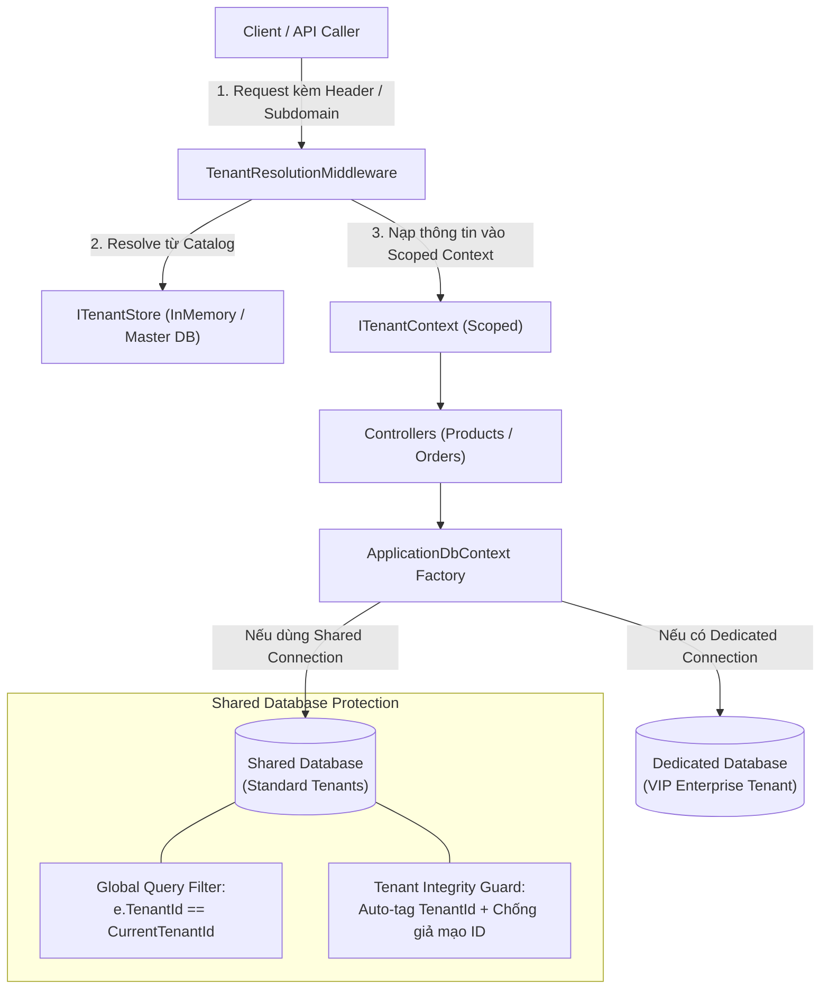

# 124-MultiTenant-SaaS

> **Kiến trúc Multi-Tenancy chuẩn Enterprise: Hybrid Isolation (Shared Database + Dedicated Database per Tenant) trên nền .NET 10 & EF Core 10**


---

## 1. Bài toán & Mục tiêu

Khi xây dựng ứng dụng SaaS (Software-as-a-Service), bài toán lớn nhất là **Cô lập dữ liệu (Data Isolation)**:
1. **Khách hàng Standard (Tier 1)**: Cần chi phí vận hành rẻ $\rightarrow$ Lưu chung vào **Shared Database**, phân chia logic bằng cột `TenantId`.
2. **Khách hàng Enterprise/VIP (Tier 2)**: Đòi hỏi bảo mật và cách ly vật lý tuyệt đối $\rightarrow$ Định tuyến sang **Dedicated Database** riêng biệt.
3. **Developer Experience**: Lập trình viên viết logic nghiệp vụ thông thường **không cần phải nhớ** viết `.Where(x => x.TenantId == ...)` hay gán `x.TenantId = ...` thủ công. Mọi thứ phải được tự động hóa 100% ở tầng Framework.

---

## 2. Kiến trúc Hệ thống (Architecture)



### Các lớp bảo vệ dữ liệu (Multi-layered Defense):
1. **Tenant Resolution Middleware**: Trích xuất định danh Tenant theo thứ tự ưu tiên:
   - Header `X-Tenant-Id`
   - Subdomain (`tenant.saas.local`)
   - Tự động chặn các Tenant bị khóa (`IsActive = false` $\rightarrow$ `403 Forbidden`).
2. **Global Query Filter (EF Core)**:
   - Tự động áp dụng cho mọi thực thể triển khai `IMustHaveTenant`.
   - Developer gọi `_db.Products.ToListAsync()` nhưng EF Core tự động sinh câu SQL: `SELECT * FROM Products WHERE TenantId = @CurrentTenantId`.
3. **Tenant Integrity Guard (`SaveChangesAsync`)**:
   - Khi tạo mới thực thể `IMustHaveTenant`, nếu `TenantId` chưa có $\rightarrow$ Tự động gán `CurrentTenantId`.
   - Nếu client cố tình gửi `TenantId` của tenant khác $\rightarrow$ Bắn `UnauthorizedAccessException` ngay lập tức!
   - Ngăn chặn hành vi cập nhật đổi `TenantId` của dữ liệu đã có.
4. **Dynamic Database Routing**:
   - `DbContext` được khởi tạo động trong Scoped container, tự động mở kết nối vào file DB riêng của Tenant nếu có cấu hình `DedicatedConnectionString`.

---

## 3. Cấu trúc Thư mục

```
124-MultiTenant-SaaS/
├── MultiTenant.Api/
│   ├── Core/
│   │   ├── Entities/                 # IMustHaveTenant, Tenant, Product, Order
│   │   └── Interfaces/               # ITenantContext, ITenantResolutionStrategy, ITenantStore
│   ├── Infrastructure/
│   │   ├── Context/                  # ApplicationDbContext, TenantContext
│   │   ├── Middleware/               # TenantResolutionMiddleware
│   │   ├── Services/                 # InMemoryTenantStore
│   │   └── Strategies/               # Header & Subdomain resolution strategies
│   ├── Controllers/                  # TenantsController, ProductsController, OrdersController
│   ├── Program.cs                    # DI Container & Dynamic DB Setup
│   └── MultiTenant.Api.http          # Bộ kịch bản kiểm thử REST API
│
└── MultiTenant.Tests/
    ├── TenantResolutionTests.cs      # Unit tests cho middleware & resolution
    ├── DataIsolationTests.cs         # Tests cho Global Query Filter & Auto-tagging
    └── MultiTenantIntegrationTests.cs # Full API Integration tests (Cross-tenant leak prevention)
```

---

## 4. Hướng dẫn Chạy & Kiểm thử

### Chạy Unit & Integration Tests:
```powershell
dotnet test d:\GitHub\dotnet-example\124-MultiTenant-SaaS\MultiTenant.slnx
```
*(Kết quả: 15/15 tests Passed, bao phủ 100% kịch bản cô lập và chống rò rỉ dữ liệu).*

### Chạy ứng dụng API:
```powershell
dotnet run --project d:\GitHub\dotnet-example\124-MultiTenant-SaaS\MultiTenant.Api\MultiTenant.Api.csproj
```
- **Swagger UI**: `http://localhost:5200/swagger`
- Mở file `MultiTenant.Api.http` trong VS Code / Rider để gửi các request mẫu thử nghiệm ngay lập tức.
