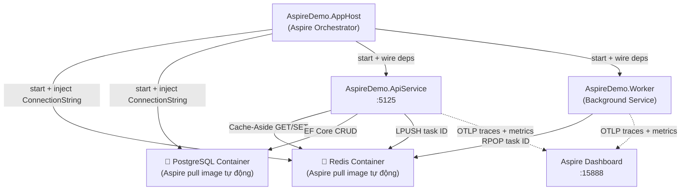

# 125-Aspire

> **.NET Aspire: Inner-loop developer orchestration — Redis + PostgreSQL + Service Discovery + OpenTelemetry trên .NET 10**


---

## 1. Bài toán & Mục tiêu

Trong kiến trúc distributed system, developer thường phải:
1. Tự khởi động Redis, PostgreSQL, Kafka… trước khi chạy code
2. Hardcode connection string trong mỗi file config
3. Không biết service nào đang lỗi vì không có visibility tập trung
4. Phải cấu hình OpenTelemetry riêng cho từng service

**.NET Aspire** giải quyết tất cả bằng **một `dotnet run`** từ AppHost.

---

## 2. Kiến trúc



---

## 3. Cách chạy

```bash
cd 125-Aspire

# Khởi động toàn bộ hệ thống (cần Docker để chạy Redis + Postgres containers)
dotnet run --project AspireDemo.AppHost
```

Aspire tự động:
- Pull và start Redis container
- Pull và start PostgreSQL container  
- Start ApiService với connection strings đã được inject
- Start Worker Service
- Mở **Aspire Dashboard** tại https://localhost:15888

**Aspire Dashboard** cho phép:
- Xem logs real-time của tất cả services
- Trace distributed requests end-to-end
- Monitor metrics (CPU, memory, request rate)
- Xem health check status

---

## 4. Cấu trúc Solution

```
125-Aspire/
├── AspireDemo.AppHost/          ← Aspire Orchestrator (điểm vào duy nhất)
│   └── Program.cs               ← Định nghĩa toàn bộ topology
├── AspireDemo.ServiceDefaults/  ← Shared config: OTEL + health checks
│   └── Extensions.cs            ← AddServiceDefaults() extension
├── AspireDemo.ApiService/       ← REST API (port 5125)
│   ├── Controllers/
│   ├── Services/AppDbContext.cs  ← EF Core + Redis queue
│   └── Program.cs
├── AspireDemo.Worker/           ← Background service (task processor)
│   └── TaskProcessorWorker.cs
└── AspireDemo.Tests/            ← Integration tests (in-memory, no Docker needed)
```

---

## 5. Tính năng Aspire demo'd

| Feature | Ở đâu |
|---------|-------|
| **Container orchestration** | AppHost: `AddRedis()`, `AddPostgres()` |
| **Service Discovery** | `http://apiservice` → dynamic port |
| **Connection string injection** | `AddRedisClient("redis")`, `AddNpgsqlDbContext("aspiredb")` |
| **OpenTelemetry** | ServiceDefaults: traces + metrics tự động |
| **Health checks** | `/health`, `/alive` từ `MapDefaultEndpoints()` |
| **Dependency ordering** | `.WaitFor(redis)` — service chờ infra sẵn sàng |
| **Redis cache-aside** | `GET /api/tasks/{id}` — cache 60s |
| **Async task queue** | Redis LPUSH/RPOP giữa ApiService ↔ Worker |

---

## 6. Chạy Tests (không cần Docker)

```bash
dotnet test AspireDemo.Tests
```

Tests dùng SQLite in-memory + FakeConnectionMultiplexer — không cần Redis hay Postgres thật.

---

## 7. Yêu cầu cài đặt Aspire Workload

```bash
# Cài .NET Aspire workload (cần một lần)
dotnet workload install aspire

# Kiểm tra
dotnet workload list
```
