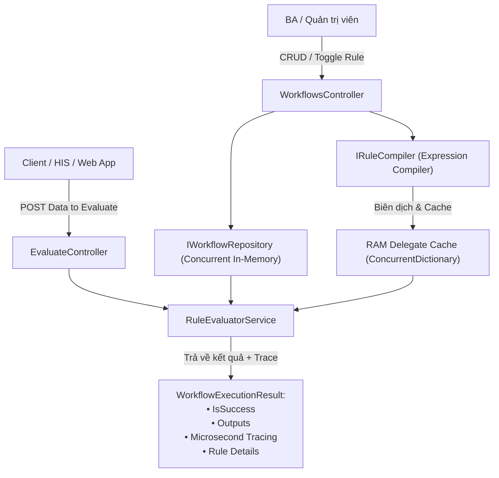

# 125-Dynamic-RuleEngine

> **Động cơ Quy tắc Nghiệp vụ Động (.NET 10): Biên dịch Dynamic Expression Trees, Caching RAM, Hot-Reload không cần restart, áp dụng bài toán BHYT & E-Commerce**


---

## 1. Bài toán & Mục tiêu

Trong các hệ thống lớn như **Quản lý Bệnh viện (HIS)**, **Tài chính**, hay **Thương mại điện tử**, các quy tắc nghiệp vụ liên tục thay đổi:
- Thay đổi tỷ lệ chi trả BHYT theo thông tư mới của Bộ Y tế.
- Đổi chính sách giảm giá cho khách hàng VIP theo mùa bán hàng.

**Vấn đề**: Nếu dùng code `if-else` cứng trong backend:
1. Mỗi lần đổi luật phải sửa code, commit, build, test hồi quy và deploy lại toàn bộ service.
2. Dễ phát sinh lỗi ngoài ý muốn ở các luồng logic khác.

**Giải pháp của Project 125**:
- Cho phép cấu hình biểu thức logic động (ví dụ: `Age >= 60 and HasChronicDisease == true and IsRightRoute == true`) qua API/JSON.
- Biên dịch biểu thức thành C# Delegate tối ưu hóa trong RAM với tốc độ thực thi cực đại ($< 1\text{ms}$).
- Hỗ trợ **Hot-Reload**: Bật/tắt luật hoặc nạp luật mới có tác dụng tức thì mà **không cần restart ứng dụng**.

---

## 2. Kiến trúc Hệ thống



### Các tính năng cốt lõi:
1. **Dynamic Expression Compilation**:
   - Sử dụng `System.Linq.Dynamic.Core` biên dịch chuỗi text thành `Func<T, bool>` chạy trực tiếp bằng CPU (JIT Compiled).
   - Tự động cache delegate trong RAM (`ConcurrentDictionary`), lần gọi thứ 2 trở đi đạt tốc độ hàng trăm nanosecond.
2. **Security Sandbox Whitelist**:
   - Tự động chặn đứng các biểu thức chứa từ khóa nguy hiểm (`System.IO`, `Process.`, `File.`, `Environment.`, `Reflection`) tránh lỗ hổng Code Injection.
3. **Execution Tracing (Kiểm toán chi tiết)**:
   - Trả về chi tiết: Từng rule tốn bao nhiêu microsecond ($\mu s$), luật nào thỏa mãn (`Pass`), luật nào bị trượt (`Fail`).
4. **Cờ `StopOnSuccess` (Short-circuit Evaluation)**:
   - Khi một luật ưu tiên cao thỏa mãn (ví dụ: trẻ em được hưởng 100%), hệ thống tự động ngắt và không cần duyệt tiếp các luật phía sau, tối ưu hóa tối đa CPU.

---

## 3. Cấu trúc Dự án

```
125-Dynamic-RuleEngine/
├── DynamicRuleEngine.Api/
│   ├── Domain/
│   │   ├── Models/               # Rule, Workflow, RuleResult, RuleAction
│   │   ├── UseCases/             # MedicalInsuranceContext (BHYT), OrderDiscountContext
│   │   └── Interfaces/           # IRuleCompiler, IWorkflowRepository, IRuleEvaluator
│   ├── Infrastructure/
│   │   ├── Compilers/            # ExpressionRuleCompiler (Dynamic Expression + Sandbox)
│   │   ├── Repositories/         # InMemoryWorkflowRepository (Seeded BHYT & E-Commerce)
│   │   └── Services/             # RuleEvaluatorService (Stopwatch Tracing)
│   ├── Controllers/              # WorkflowsController, EvaluateController
│   ├── Program.cs                # DI Container Setup
│   └── DynamicRuleEngine.Api.http # File test REST Client
│
└── DynamicRuleEngine.Tests/
    ├── RuleCompilerTests.cs      # Tests cho trình biên dịch, cache và bảo mật
    ├── MedicalInsuranceRulesTests.cs # Tests cho kịch bản BHYT viện phí
    └── RuleEngineIntegrationTests.cs # Full API Integration tests + Hot-Reload verification
```

---

## 4. Hướng dẫn Chạy & Kiểm thử

### Chạy Unit & Integration Tests:
```powershell
dotnet test d:\GitHub\dotnet-example\125-Dynamic-RuleEngine\DynamicRuleEngine.slnx
```
*(Kết quả: 15/15 tests Passed, thời gian chạy ~1.3s).*

### Khởi chạy API Server:
```powershell
dotnet run --project d:\GitHub\dotnet-example\125-Dynamic-RuleEngine\DynamicRuleEngine.Api\DynamicRuleEngine.Api.csproj
```
- **Swagger UI**: `http://localhost:5125/swagger`
- **File Test REST**: Mở file [`DynamicRuleEngine.Api.http`](file:///d:/GitHub/dotnet-example/125-Dynamic-RuleEngine/DynamicRuleEngine.Api/DynamicRuleEngine.Api.http) để trải nghiệm trực tiếp các ca BHYT và Chiết khấu.
