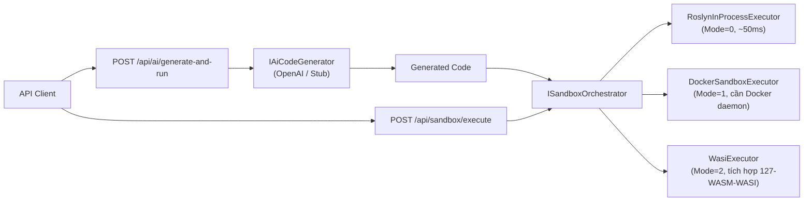

# 126-AI-Code-Sandbox

> **Thực thi code an toàn từ AI: Microsoft.Extensions.AI + Roslyn CSharpScript + Docker Sandbox trên .NET 10**


---

## 1. Bài toán & Mục tiêu

Khi tích hợp AI sinh code vào sản phẩm, câu hỏi quan trọng nhất là:
**"Code AI sinh ra có thể chạy được không? Và chạy an toàn thế nào?"**

Project này giải quyết 3 vấn đề:
1. **Sinh code từ ngôn ngữ tự nhiên** → `Microsoft.Extensions.AI` (provider-agnostic: OpenAI, Ollama, LM Studio...)
2. **Thực thi C# ngay lập tức** → `Roslyn CSharpScript` (không cần build, ~50ms cold start)
3. **Sandbox cô lập hoàn toàn** → `Docker container` với memory/CPU limit, network off

---

## 2. Kiến trúc



---

## 3. Các chế độ thực thi

| Mode | Enum | Thư viện | Tốc độ | Cô lập | Use case |
|------|------|----------|--------|--------|----------|
| **InProcess** | `0` | Roslyn CSharpScript | ~50ms | Thấp | Dev, demo, trusted code |
| **Docker** | `1` | Docker.DotNet SDK | ~2-5s | Cao | Untrusted code, production |
| **Wasi** | `2` | Wasmtime (xem 127) | ~10ms | Cao | Cross-language, edge |

---

## 4. Cách chạy

```bash
cd 126-AI-Code-Sandbox
dotnet run --project AiCodeSandbox.Api

# Tùy chọn: đặt OpenAI API key để dùng AI thật
# set OPENAI_API_KEY=sk-...     (Windows)
# export OPENAI_API_KEY=sk-...  (Linux/Mac)
```

Swagger UI: http://localhost:5126/swagger

---

## 5. API Endpoints

| Method | Path | Mô tả |
|--------|------|-------|
| `POST` | `/api/sandbox/execute` | Thực thi code trực tiếp |
| `POST` | `/api/ai/generate` | AI sinh code (không chạy) |
| `POST` | `/api/ai/generate-and-run` | AI sinh code + chạy ngay |

---

## 6. Cấu hình AI Provider

```json
// appsettings.json hoặc env var
{
  "OpenAI": { "ApiKey": "sk-..." }
}
```

Nếu không có API key → tự động dùng `StubAiCodeGenerator` (không cần internet, trả code mẫu cứng).

---

## 7. Bảo mật

⚠️ **InProcess mode KHÔNG an toàn cho untrusted input**:
- Code chạy trong cùng process, có thể đọc file, gọi network
- **Chỉ dùng** cho dev/demo hoặc trusted users

✅ **Docker mode** cung cấp cô lập thực sự:
- `--memory 128m --cpus 0.5 --network none --read-only`
- Container bị destroy sau mỗi execution

---

## 8. Chạy Tests

```bash
dotnet test AiCodeSandbox.Tests
```

9 test cases bao phủ: thực thi thành công, runtime exception, timeout, AI generation, performance.
