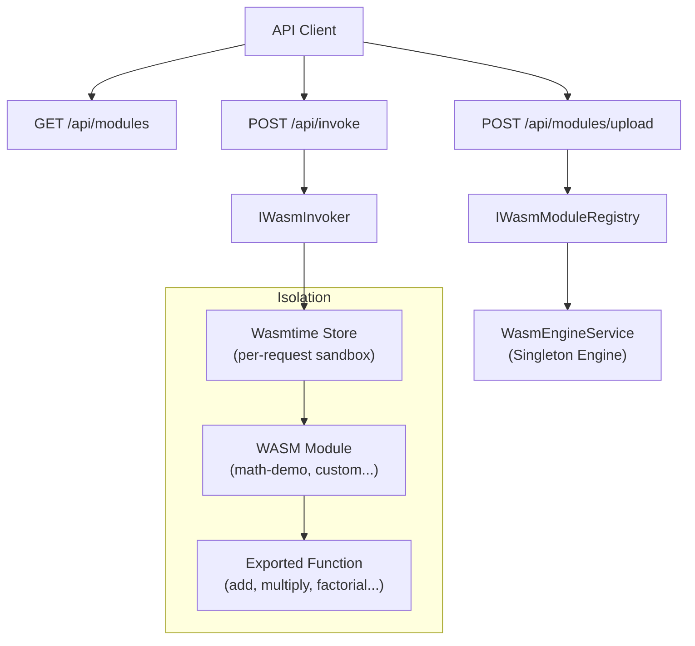

# 127-WASM-WASI

> **WebAssembly + WASI trong .NET 10: Wasmtime, sandboxed execution, dynamic module loading**


---

## 1. Bài toán & Mục tiêu

WebAssembly (WASM) không chỉ dành cho browser. Trong server-side .NET, WASM giải quyết:

1. **Plugin sandbox an toàn**: Load code từ bên ngoài, chạy cô lập, không thể escape process
2. **Cross-language interop**: Rust/C/Go/Python compile sang `.wasm`, .NET gọi được ngay
3. **Portable business rules**: Deploy logic dưới dạng `.wasm` binary, không cần redeploy server
4. **Fuel metering**: Giới hạn số instruction → tự động kill infinite loop, không cần timeout thread

---

## 2. Kiến trúc



---

## 3. Demo Module: math-demo

Module được compile tự động từ WAT (WebAssembly Text Format) khi khởi động:

| Function | Signature | Ví dụ |
|----------|-----------|-------|
| `add` | `(i32, i32) → i32` | add(10, 32) = 42 |
| `multiply` | `(i32, i32) → i32` | multiply(7, 6) = 42 |
| `factorial` | `(i32) → i32` | factorial(10) = 3628800 |

---

## 4. Cách chạy

```bash
cd 127-WASM-WASI
dotnet run --project WasmWasi.Api
```

Swagger UI: http://localhost:5127/swagger

---

## 5. API Endpoints

| Method | Path | Mô tả |
|--------|------|-------|
| `GET` | `/api/runtime` | Thông tin Wasmtime runtime |
| `GET` | `/api/modules` | Danh sách WASM modules |
| `GET` | `/api/modules/{name}` | Chi tiết một module |
| `POST` | `/api/modules/upload?name=X` | Upload WASM binary |
| `POST` | `/api/invoke` | Gọi function trong module |

---

## 6. Upload Module tự viết

```bash
# Compile WAT → WASM (cần wabt tools)
wat2wasm my-plugin.wat -o my-plugin.wasm

# Upload qua API
curl -X POST "http://localhost:5127/api/modules/upload?name=my-plugin" \
  -H "Content-Type: application/octet-stream" \
  --data-binary @my-plugin.wasm
```

Hoặc compile Rust → WASM:
```bash
cargo build --target wasm32-wasi --release
# → target/wasm32-wasi/release/my_lib.wasm
```

---

## 7. Fuel Metering (Bảo vệ khỏi Infinite Loop)

```csharp
// Mỗi Store được cấp 1,000,000 fuel đơn vị instruction
store.SetFuel(1_000_000);

// WASM sẽ throw TrapException khi hết fuel
// → Không cần Thread.Abort hay CancellationToken race condition
```

---

## 8. Chạy Tests

```bash
dotnet test WasmWasi.Tests
```

11 test cases: module listing, function invocation, error handling, performance (< 500ms/call).

---

## 9. Roadmap

- [ ] WASI Preview 2 (Component Model)
- [ ] Python/Rust plugin examples
- [ ] Persistent module store (SQLite / blob storage)
- [ ] Tích hợp với 126-AI-Code-Sandbox (WASI execution mode)
