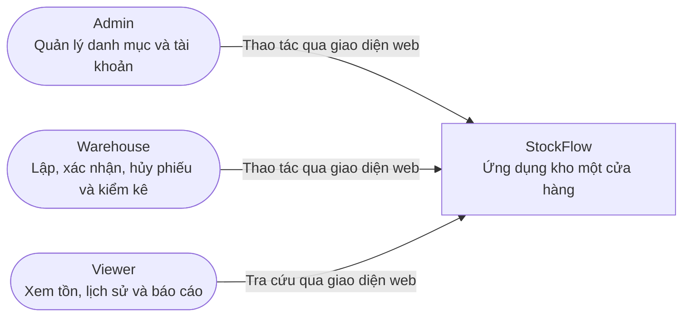
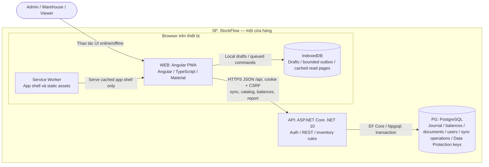
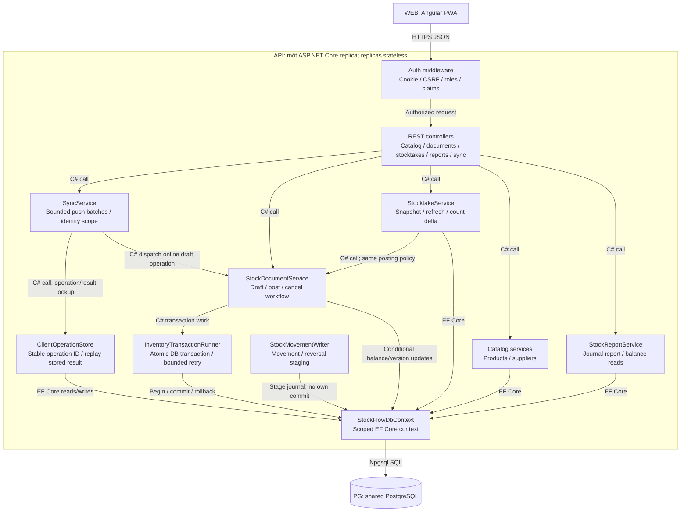
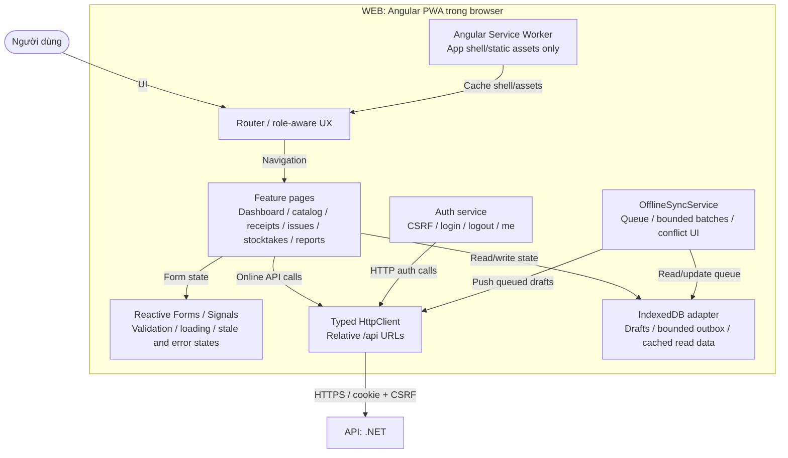
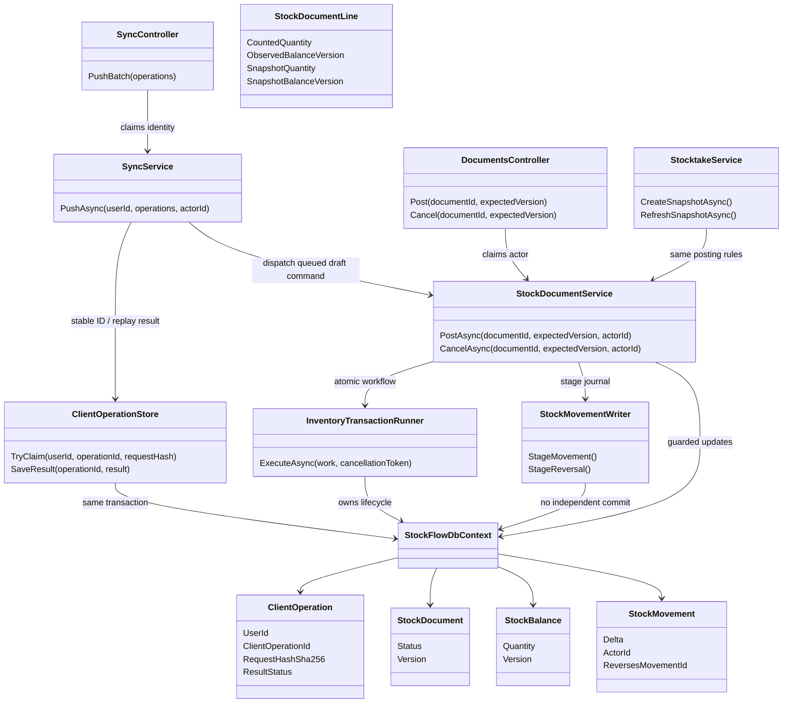
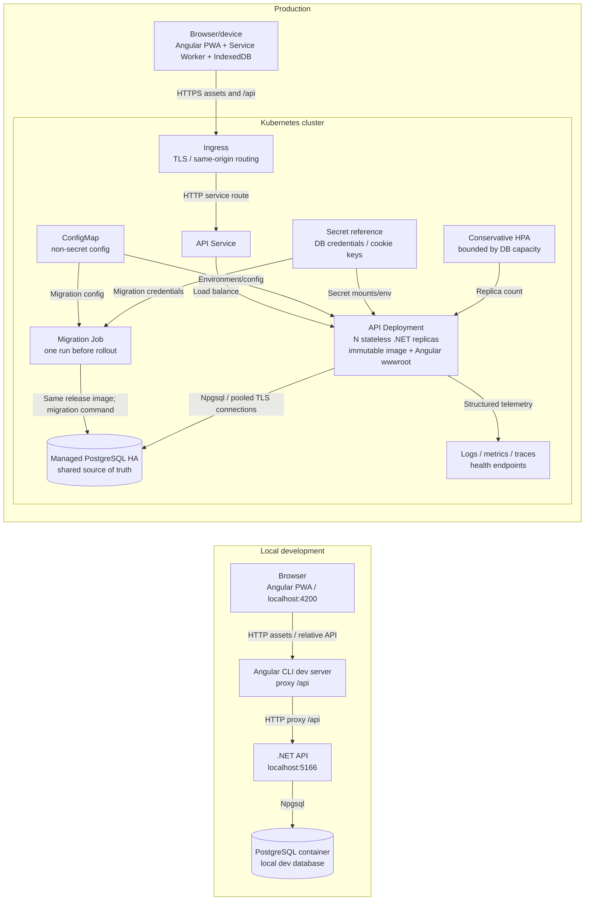

# StockFlow — thiết kế C4 đề xuất

**Trạng thái:** Proposed — chờ review. Đây là thiết kế mục tiêu, không khẳng định ứng dụng đã được triển khai.

**Nguồn:** [Kế hoạch StockFlow](../2026-10-01-stockflow-plan.md). Đường dẫn source dưới `128-StockFlow/` là đề xuất.

Mục tiêu là phần mềm kho một cửa hàng: quản lý nhập, xuất, kiểm kê và lịch sử tồn. Angular PWA cho phép làm việc ngoại tuyến với bản nháp và số đếm kiểm kê đã lưu trên thiết bị. Server mới xác nhận phiếu và thay đổi tồn chính thức. Backend .NET 10 stateless chạy nhiều replica trên Kubernetes; PostgreSQL là nguồn dữ liệu dùng chung, gồm cả Data Protection key ring cần thiết để mọi replica giải mã auth cookie.

## Quy ước sơ đồ

- Khung biểu diễn ranh giới hệ thống, process, browser hoặc cluster; không mặc định đó là Docker container.
- Mũi tên ghi thao tác, giao thức và công nghệ. Lời gọi C#/TypeScript trong C3 chạy cùng process, không phải HTTP nội bộ.
- ID C2 được giữ nhất quán giữa browser/API/database. C3 dùng ID riêng cho component trong từng view; deployment thể hiện đúng các runtime C2 cùng hạ tầng.
- “Offline” nghĩa là mở app, đọc dữ liệu được cache có cảnh báo cũ, nhập/lưu draft và kiểm kê trên thiết bị. Khi offline không thể xác nhận tồn toàn cục hoặc bảo đảm nhiều thiết bị không bán vượt tồn; v1 không phân bổ quota/reservation.

## C1 — System context: toàn bộ StockFlow



Ba vai trò dùng chung một kho và một hệ thống. Quyền lấy từ ASP.NET Identity/policy; UI chỉ thể hiện quyền. Không có tích hợp hãng vận chuyển, ngân hàng, nhà cung cấp bên ngoài hoặc đăng ký công khai trong v1.

## C2 — Containers: PWA, API và dữ liệu



Trong production, WEB là Angular bundle tĩnh được API phục vụ cùng origin qua Ingress/TLS. Service Worker chỉ cache app shell/static assets, không cache credential hoặc response riêng tư từ API. IndexedDB chứa bản nháp, outbox có giới hạn và các trang catalog/balance đã đọc; không chứa mật khẩu/token. Khi online, UI tải lại dữ liệu tra cứu qua REST pagination thay vì giữ global delta-feed cursor. Cached data phải hiện dấu thời điểm cập nhật và không được trình bày như dữ liệu mới nhất.

| C2 | Trách nhiệm | Runtime hoặc dữ liệu |
|---|---|---|
| WEB | Giao diện, local-first drafts, trạng thái đồng bộ, gọi REST API | Angular PWA trong browser |
| API | Auth, validation, workflow phiếu, idempotent sync, transaction tồn kho | Stateless .NET 10 replicas |
| PG | Nguồn dữ liệu chuẩn cho users, catalog, documents, journal, balances, operation results và Data Protection key ring | PostgreSQL HA-managed, dùng chung cho replicas |
| IDB | Bản nháp, thao tác chờ sync, cached read pages và observed balance versions; dữ liệu cục bộ theo browser/user | IndexedDB trên từng thiết bị |
| SW | Cấp app shell/static files đã cache khi offline | Angular Service Worker trong browser |

Local development ưu tiên PostgreSQL bằng Docker Compose; SQLite chỉ là tùy chọn cho unit test cô lập, không dùng làm bằng chứng concurrency hoặc cấu hình production. Không mount file SQLite chung giữa các API replicas. Tests tích hợp chạy PostgreSQL thật bằng Testcontainers hoặc service container.

## C3 — API components: bên trong một API replica



`ClientOperationStore` and inventory mutation use the same PostgreSQL transaction: claim `(UserId, ClientOperationId)`, apply a draft sync or return the previously stored result, and persist the response outcome atomically. A unique constraint backs idempotency across retries and API replicas. Batch size/payload is bounded. Actor always comes from the current authenticated cookie claims, never from an offline payload.

Document posting changes status, conditional `StockBalance` rows, and `StockMovement` rows in one transaction. Updates guard expected version and `quantity >= requested`; process product IDs in stable order to limit deadlocks. A multi-line failure rolls the whole document back. PostgreSQL transient retry repeats the complete idempotent command within a bounded request budget. A readiness probe must not turn every database blip into an unbounded retry loop.

The journal is the audit/report source; `StockBalance` is the current projection updated atomically with it. Dashboard reads balances; period report/history reads the journal. No API replica keeps authoritative inventory state in memory.

### C3 — Browser components: Angular PWA



When offline, forms create/update locally persisted drafts and stocktake counts. Each queued operation receives stable client-generated document and `clientOperationId` UUIDs before it is stored; retry reuses the same ID. The queue is bound to the user ID from the last online session, contains no credential, and sync requires re-authentication as that same user. If identity differs, stop and retain the queue for its owner.

The UI shows `Chưa đồng bộ`, `Đã đồng bộ`, or `Cần xử lý`, pending count, and last-sync time. On reconnect/app open it sends bounded batches. A `409` keeps the local copy and presents local/server versions for user review; quantity edits are not auto-merged. Post/Cancel are disabled offline. A locally prepared draft can become officially Posted only after the online server validates and commits it. Since devices can be disconnected concurrently, this design cannot guarantee global no-oversell offline; preallocated stock quotas/reservations are explicitly deferred.

Service Worker cache is for versioned app shell/static assets only. Do not cache credentials or private API responses there. Do not assume Background Sync runs while the app is closed; the app syncs when reopened or when connectivity returns while active. Cached balances/catalogs carry a stale timestamp and remain read-only context.

## C4 — Code view: server posting and sync idempotency



The database enforces unique `(UserId, ClientOperationId)`, unique original movement per document line, and unique reversal link. A canonical SHA-256 request fingerprint binds an operation ID to operation type, resource, expected version, and payload: an exact retry replays the stored result, while a changed request reusing that ID returns `409 IdempotencyKeyReused`. Sync writes only drafts/local captures and uses normal validation/permissions; it does not bypass the posting state machine. An offline stocktake line carries the balance version observed when the count began; the server compares that version with its authoritative balance before capturing its own snapshot. A stale count remains local and conflicts instead of silently adopting current server quantity. The server assigns UTC timestamps and actor claims. Exact class signatures may change during implementation while retaining these boundaries.

For cookie authentication, `GET /api/auth/csrf` stores an HttpOnly antiforgery cookie and returns the request token in JSON. Angular keeps the request token in memory and a custom same-origin interceptor sends `X-XSRF-TOKEN` on unsafe `/api` methods; it does not use Angular's default cookie-reading XSRF interceptor. Both authentication and antiforgery cookies use the shared, durable Data Protection key ring.

## Dynamic view — offline draft, reconnect, and authoritative post

```mermaid
sequenceDiagram
    actor U as Warehouse
    participant W as WEB Angular PWA
    participant IDB as IndexedDB
    participant A as API replica
    participant PG as Shared PostgreSQL
    U->>W: Create/edit receipt or stocktake while offline
    W->>IDB: Save local draft + stable document ID + operation ID
    IDB-->>W: Persisted; state = Chưa đồng bộ
    Note over U,IDB: No server stock mutation; Post is disabled offline
    U->>W: Reconnect / reopen app and authenticate as same user
    W->>A: Push bounded draft batch + operation IDs + versions
    A->>PG: Claim unique operation ID and validate user/state
    alt Operation already applied
        PG-->>A: Existing stored result
        A-->>W: Return same result; do not duplicate draft/movement
    else Draft accepted
        A->>PG: Persist draft sync result atomically
        A-->>W: Accepted; state = Đã đồng bộ
        W->>IDB: Mark operation synced with authoritative response
    else Version/ownership conflict
        A-->>W: 409 ProblemDetails
        W->>IDB: Keep local data; state = Cần xử lý
        W-->>U: Compare local/server versions; user reviews
    end
    U->>W: User reviews draft and presses Post while online
    W->>A: POST /api/documents/{id}/post + expectedVersion + CSRF
    A->>PG: One transaction: conditional status/balance + journal
    alt Stale version or insufficient stock
        PG-->>A: Rollback
        A-->>W: 409; retain form for review
    else All lines valid
        PG-->>A: Commit Posted + balances + movements
        A-->>W: Posted result
    end
```

Retry of the same client operation returns its stored result; a new user edit must use a new operation ID and expected version. Final posting is always online and atomic. Reconnect does not silently turn a stale offline count into an inventory adjustment.

## Deployment view — local development and Kubernetes production



Production serves Angular assets and `/api` from the same public origin. API replicas are stateless; no local database volume or process memory is authoritative. Use managed PostgreSQL outside the application cluster as the initial production target; retain backups/HA responsibility with that service. A single Kubernetes migration Job runs before application rollout; replicas do not migrate schema on startup. ConfigMap holds non-secret configuration; database credentials and the certificate that encrypts the shared Data Protection key ring come from Kubernetes Secrets or an external secret manager. Do not commit secret values.

Expose separate startup, readiness, and liveness health checks: startup gives initialization time; readiness removes a replica from traffic when it cannot serve; liveness detects a stuck process without restarting on every dependency outage. Add graceful shutdown/termination grace, resource requests/limits, structured logs, metrics and traces. HPA is conservative and must respect PostgreSQL connection budget; a replica count alone is not a throughput guarantee. Verify workload target and report measured load/latency before claiming high capacity. No broker is required for v1 because sync commands are applied synchronously and persisted in PostgreSQL.

SQLite may remain a local-only option for isolated unit tests. It is never shared among replicas and is not the production deployment topology.

## Decisions and review checklist

- One warehouse, one fixed unit per product. Multi-warehouse, lot/expiry, valuation, profit, debt, and shipping integrations are out of scope.
- A product unit cannot change while any active draft references it or any stock movement exists. Draft writes, posting, and unit edits serialize on product rows in stable ID order so a draft's quantity never silently changes unit before posting.
- Drafts do not change authoritative stock. Posted documents are immutable; cancellation writes linked reversals. Every inventory mutation is one PostgreSQL transaction across status, balance/version, and journal.
- Offline covers app shell, stale read context, local drafts, and stocktake capture. No offline final posting, global no-oversell guarantee, quota reservation, auto-merge, or background-sync guarantee.
- Stable operation IDs bound to request hashes, server-side unique constraints, expected versions, and retained 409 local copies make sync retryable and reviewable. Actor is always the authenticated server claim.
- Offline stocktake preserves the cached per-product balance version; server-owned quantity/version determine deltas, and stale counts require explicit review.
- Reports aggregate opening/inflow/outflow/adjustments/closing in a single PostgreSQL statement so every component observes one committed snapshot.
- API replicas share PostgreSQL; no in-memory or SQLite-file source of truth. Migrations run through one release Job, not each pod.
- K8s view includes Ingress/TLS, Service, Deployment, ConfigMap/secret references, startup/readiness/liveness, graceful shutdown, observability, and cautious HPA.
- Confirm single-store business scope, stale-cache affordances, offline conflict UX, and managed PostgreSQL operations before implementation.

## References

- [C4 diagram types](https://c4model.com/diagrams) and [C4 notation](https://c4model.com/notation)
- [Angular service workers](https://angular.dev/ecosystem/service-workers) and [service worker configuration](https://angular.dev/ecosystem/service-workers/config)
- [ASP.NET Core health checks](https://learn.microsoft.com/en-us/aspnet/core/host-and-deploy/health-checks)
- [Kubernetes startup, readiness, and liveness probes](https://kubernetes.io/docs/concepts/configuration/liveness-readiness-startup-probes/) and [Jobs](https://kubernetes.io/docs/concepts/workloads/controllers/job/)
